# Computer Vision
## Lecture 1
### Introduction to Computer Vision
#### 2026-2027
---

```yaml
hideInToc: true
```
# Table of Conent
<toc maxDepth="1"/>
---

# What is Computer Vision
- It is a field of artificial intelligence and computer science that focuses on enabling machines to interpret and understand the visual world. 
- By using digital images, videos, and other visual inputs, computer vision systems can process, analyze, and extract meaningful information, and then take action or make recommendations based on that information.
- The fundamental goal of computer vision is to bridge the gap between the raw data of pixels in an image and a high-level, contextual understanding of that data, thereby replicating and automating human visual perception.
> The field draws upon a range of disciplines, including signal processing, geometry, physics, applied mathematics, and increasingly, deep learning.
---

## Key Concepts and Distinctions
- **Computer Vision vs. Image Processing:**
	- While these fields are related, they are distinct.
	- Image processing involves transformations applied to images, such as noise reduction or contrast adjustment, **without** necessarily interpreting the semantic content.
	- Computer vision, by contrast, uses the outputs of image processing to perform higher-level inference and understand the meaning of the image.   
- **Role of Deep Learning:**
	- Modern computer vision has been dramatically transformed by deep learning and neural networks, which allow systems to learn complex hierarchical feature representations directly from large sets of labeled data.
	- This approach has substantially improved accuracy on key vision tasks.
---

## Applications of Computer Vision
- **Optical Character Recognition (OCR)**: reading handwritten postal codes on letters and automatic number plate recognition (ANPR), this also extends to reading printed documents, like court transcripts.
- **Machine Inspection**: rapid parts inspection for quality assurance using stereo vision with specialized illumination to measure tolerances on aircraft wings or auto body parts or looking for defects in steel castings using X-ray vision
- **Retail**: object recognition for automated checkout lanes
- **3D Model Building (Photogrammetry)**: fully automated construction of 3D models from aerial photographs used in systems such as Bing Maps
- **Medical Imaging**: Analyzing medical images to detect fractions, tumors, ...etc.
- **Automotive Safety**: detecting unexpected obstacles such as pedestrians on the street, under conditions where active vision techniques such as radar or lidar do not work well
- **Object Tracking**: Allows to track a certain object (like car) through video file(s).
- **Motion Capture (MOCAP)**: using retro-reflective markers viewed from multiple cameras or other vision-based techniques to capture actors for computer animation

----

```yaml
hideInToc: true
```
## Applications of Computer Vision
- **Surveillance**: monitoring for intruders, analyzing highway traffic, and monitoring pools for drowning victims
- **Fingerprint Recognition and Biometrics**: for automatic access authentication as well as forensic applications
- **Civil Engineering**: To detect cracks in buildings, bridges, dams, roads and estimate the severity of said crack
- **Quality Assurance**: To check finished products against reference product making sure said products are within acceptable margins.
- **Face Detection**: To detect faces in pictures and matching them against a known database of faces and names
---

# Image Representation
- In computer science, image processing is derived from signal processing.
- Why? Because an image is a signal, just like audio, at every second we get the amplitude of the audio (the sound), while in image at every pixel we get the light wave length (the color) as seen in the shape
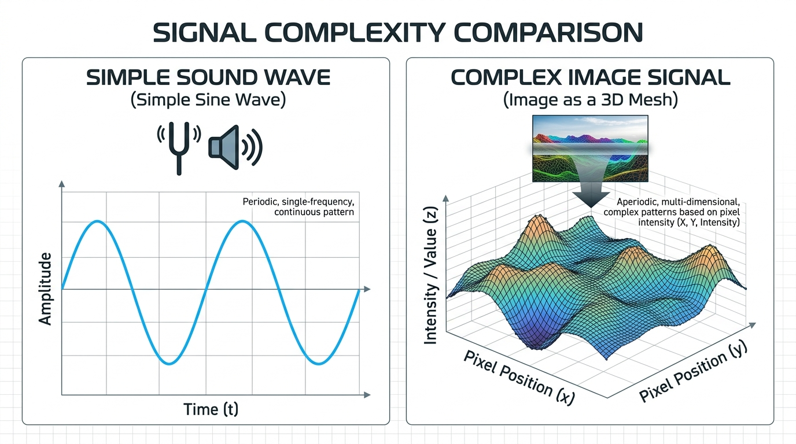
---

```yaml
hideInToc: true
```
# Image Representation
- That's why we can see the image as a 3 variable function
$$I(x,y,c)=color\ value$$
- The variable refers to:
	- $x,y$ are the location in width and height, in other words the location of the pixel
	- $c$ refers to the color channel
- What is a color channel?
	- It's a concept regarding the representation of colors in computer system
	- Requires Identifying the color system of the image
---

```yaml
hideInToc: true
```
# Image Representation
- Image representation in computer is a matrix (2D or more)
- So when we say $I(25,10,0)$ means we need to get the value of the pixel located at $x=25,y=10$ in the color channel 0 (first channel) as seen in the image below (represents a RGB image)
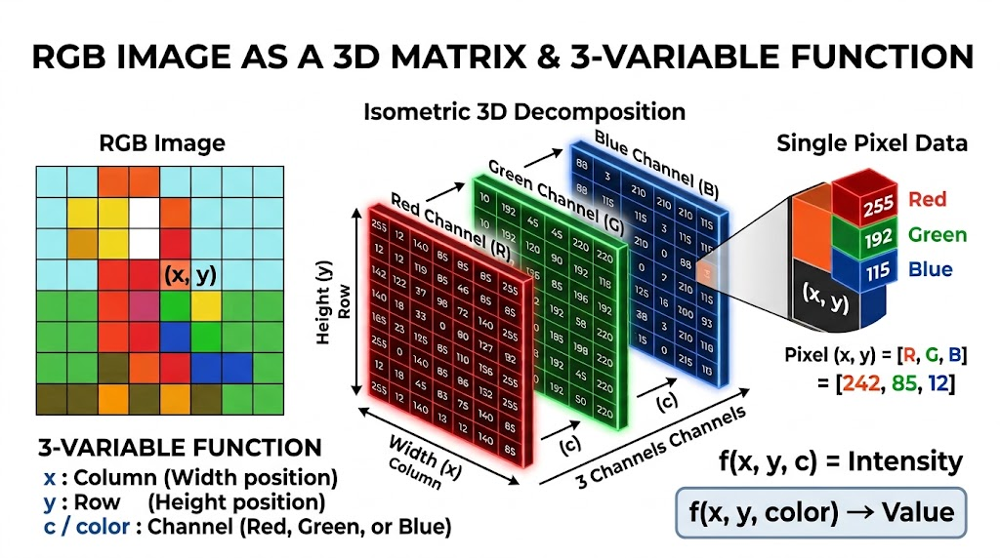
---

## Color Systems
- Color systems is a concept in digital image processing responsible for defining the supported colors and representing them in the image
- We will focus on the Following
	- RGB
	- HSV
	- CIE L\*A\*B*
	- YUV
	- Y'CbCr
---

```yaml
hideInToc: true
```
## Color Systems
### RGB
- The most common color system, it is defined as an additive color system, meaning it is based on the concept of lighting up dark background using 3 color components (channels) based on the human vision
	- Red
	- Green
	- Blue
- **Additive Principles:** Begins with a completely dark canvas $(0, 0, 0)$ where no light is emitted. Colors are generated by superimposing light wavelengths. Combining all three channels at maximum intensity produces pure white $(255, 255, 255)$   
- **Biological Basis:** Directly mirrors human trichromatic vision, matching the peak spectral sensitivities of the retina's three cone photoreceptors
---

```yaml
hideInToc: true
```
## Color Systems
### RGB
- The following image represents the RGB color cube, it is a 3D Cartesian coordinate system, the start $(0,0,0)$ is black (no light) while the end, usually $(255,255,255)$, represents the white color
<video style="width: 90%" autoplay muted loop playsinline><source src="./data/01/rgb.mp4" type="video/mp4"/></video>
---

```yaml
hideInToc: true
```
## Color Systems
### HSV
- Instead of representing the individual colors, we use a cone!
- HSV represents a color using 3 components:
	- **H**: Hue, the color wavelength based on its angle on the color wheel
	- **S**: Saturation, how much there is a color in the color
	- **V**: Value, the amount of brightness in the color
- Instead of representing the color based on its color components, we represent each color as a wavelength, saturation, and value
- Unlike RGB, which requires all 3 colors to increase at the same value to increase brightness, we only increase V to increase brightness of a color
---

```yaml
hideInToc: true
```
## Color Systems
### HSV
- The Hue value 0 represents the color red
- the higher the saturation, the more vibrant/bright the color (فاقع)
- The value indicates the amount of light/brightness from pure black ($0\%$) to full color ($100\%$).
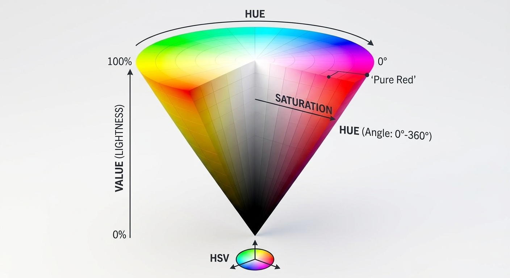
---

```yaml
hideInToc: true
```
## Color Systems
### HSV
- To convert from RGB to HSV we use these equations:

$$
M = max(R,G,B)
\\
m = min(R,G,B)
\\
V= \frac{M}{Max Value}
$$
$$
S=\begin{cases}
1 - \dfrac{m}{M}, & M > 0 \\
0, & M = 0
\end{cases}
$$
$$
H= cos^{-1}\left[  \dfrac{R-\dfrac{1}{2}G-\dfrac{1}{2}B}{\sqrt{R^2+G^2+B^2-RG-RB-GB}} \right]
\\
if(B>G)
\\
H=360-H
$$

- In 99% of cases Max Value is 255

---

```yaml
hideInToc: true
```
## Color Systems
### CIE L\*A\*B*
- Humans see a broad spectrum of colors and color shades. However, color perception differs between individuals. Not only that, but color across devices such as monitors and printers can vary significantly unless these devices are properly calibrated
- Even among the wavelength of light, we don't perceive the same colors equally:
	- We are more sensitive to green than the red and blue
	- We are less sensitive to blue than red and green
- As a result a color system was developed that mimics the human vision, and at the same time is device independent
- This color system was defined by the International Commission on Illumination. It represents colors using three components:
	- Lightness.
	- A and B: represent the four distinctive colors in the human visual system: red, green, blue, and yellow.
		- How 2 values would represent 4 colors?
		- **NOT REQUIRED** the conversion equations
---

```yaml
hideInToc: true
```
## Color Systems
### CIE L\*A\*B*
<div grid="~ cols-2 gap-1">
<div>

- CIEL\*A\*B* was developed as a color space to be used for the specification of color differences
	- The Component L measures Lightness (perceived luminance, 0 dark, 100 light)
	- The Component A* is an axis where values move between green (negative value) and red (positive value)
	- The Component B* is an axis where values move between blue (negative values) and yellow (positive values)
	- If both A* and B* are zeroes, we get a gray scale from total black to complete white
</div>
<div>
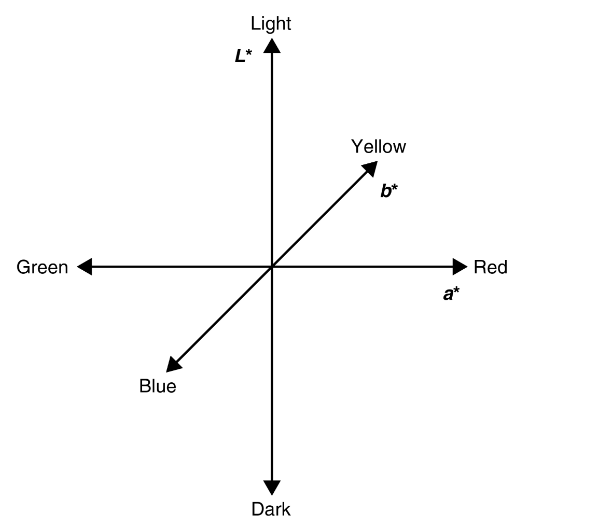
</div>
</div>
---

## Color System
### YUV & Y'CbCr
- Both **YUV** and **YCbCr** belong to a family of color spaces that separate luminance (brightness) from chrominance (color)
- Unlike CIELAB, which is designed to model uniform human visual perception, YUV and YCbCr were designed for transmission and compression efficiency in analog broadcast, video encoding, and image processing.
-  Core Principle: Decoupling Luminance and Chrominance, both formats split image data into three distinct signals:
	1. **Luminance Channel ($Y$ / $Y'$):** Contains grayscale brightness information (details, edges, contrast).
	2. **Chrominance Channels ($U, V$ or $Cb, Cr$):** Contain color difference information.
- Why do this?
	- Human vision is significantly more sensitive to fine structural detail (brightness) than to subtle spatial color changes (chroma).
	- By isolating color onto separate channels, video systems can compress or downsample the color data (**chroma subsampling**) without the human eye noticing a severe loss in picture quality.
---

```yaml
hideInToC: true
```
## Color System
### YUV & YCbCr
-  Key Differences: YUV vs. Y'CbCr
	- While the terms are often used interchangeably in software documentation, they refer to different domains:

| **Feature**        | **YUV**                                                               | **YCbCr**                                                                                          |
| ------------------ | --------------------------------------------------------------------- | -------------------------------------------------------------------------------------------------- |
| **Domain**         | **Analog** composite/component video signals (PAL/NTSC TV broadcast). | **Digital** encoding (JPEG, MPEG, H.264, H.265, WebP).                                             |
| **Signals**        | $Y$ (Luma), $U$ (Blue diff), $V$ (Red diff).                          | $Y'$ (Luma), $Cb$ (Chroma Blue), $Cr$ (Chroma Red).                                                |
| **Representation** | Continuous electrical voltage levels ($0V$ to $1V$).                  | Discrete integer values (typically 8-bit: $0\text{--}255$ or 10-bit).                              |
| **Scale Range**    | Standardized continuous voltage limits.                               | **Full Range:** $0\text{--}255$<br>**Limited/TV Range:** $Y \in [16, 235]$, $Cb/Cr \in [16, 240]$. |

---

```yaml
hideInToC: true
```
## Color System
### YUV & Y'CbCr
**RGB -> Y'CbCr**
$$\begin{aligned} Y' &= 0.299 R' + 0.587 G' + 0.114 B' \\ Cb &= 128 - 0.168736 R' - 0.331264 G' + 0.500 B' \\ Cr &= 128 + 0.500 R' - 0.418688 G' - 0.081312 B' \end{aligned}$$
**RGB -> YUV**
$$\begin{aligned} Y &= 0.299 R' + 0.587 G' + 0.114 B' \\ U &= -0.147137 R' - 0.288863 G' + 0.436000 B' \\ V &= 0.615000 R' - 0.514988 G' - 0.100012 B' \end{aligned}$$
---

## Color System
### Channel/Color Depth
- This value describes how many bits are used to store the value of a certain channel within a color space. 
	- The most widely used value is 8 bits, which is why 255 is the standard maximum channel value in common RGB spaces ($2^8 = 256$ total values, $0\text{--}255$).
	- However, this value is not set in stone:
		* **6 bits:** Common in lower-end monitors to reduce manufacturing costs.
		* **10 bits:** Used in high-end monitors designed for color grading and video editing. 
		* **16-bit / 32-bit:** Used in specialized cases (such as RAW photo processing and 3D rendering), though memory usage increases significantly. 
- **To summarize:** 
	* **Color Space:** Describes *how* color information is represented and structured. 
	* **Channel / Color Depth:** Describes the *data resolution (bit length)* used to store that information.
---

```yaml
hideInToc: true
```
## Color System
### Channel/Color Depth
- There is a common computing technique that simplifies operations across different channel depths: **converting pixel values to floating-point numbers (`float` or `double`).**
- Instead of working directly with an integer matrix (e.g., 0–255 for 8-bit or 0–1023 for 10-bit), the image matrix is normalized so that:
	* **Maximum value:** $1.0$ (representing full intensity or white)
	* **Minimum value:** $0.0$ (or $-1.0$, depending on color spaces like $a^*, b^*$ in CIELAB or $U, V$ in YUV)
- **Why Use This Technique?**
	1. **Simplified Codebase:** Algorithms (e.g., brightness adjustments, filters, blending, edge detection) can be written using a single unified scale without needing special branch logic for 8-bit, 10-bit, or 16-bit inputs.
	2. **Precision & Overflow Prevention:** Intermediate calculations won't suffer from integer truncation or wraparound overflow errors (e.g., $250 + 20$ wrapping around to $14$ in 8-bit `uint8`).
- Once all matrix operations and transformations are complete, the values are scaled back and converted to the target integer data type.

> **Trade-off:** While this simplifies algorithm design, it increases both memory usage and compute overhead. A `double` takes 8 bytes per channel value compared to just 1 byte for an 8-bit integer (`uint8`), and floating-point matrix arithmetic is generally more resource-intensive than integer operations.

> **In The Real World** We usually use float data type (4 bytes) instead of double (8 bytes) to balance speed, memory and accuracy

---

```yaml
hideInToc: true
```
## Color System
### Channel/Color Depth
- What if we had just one color channel?
- In that case the image is grayscale, not color
- In other words, old black & white T.V. image
---

# Digital Image Acquisition
- Let's learn the 4 fundamentals needed to capture a good image
	- Sensor size.
	- Aperture.
	- ISO.
	- Shutter speed.
---

```yaml
hideInToc: true
```
## Sensor Size
- Cameras are not created equal. A primary reason dedicated professional cameras produce superior images compared to mobile devices comes down to **sensor size**.
-  **Example Scenario**
	- Consider two 50-megapixel sensors:
		* **Sensor A:** Area of $3\text{ cm}^2$ (e.g., smartphone/compact sensor)
		* **Sensor B:** Area of $20\text{ cm}^2$ (e.g., full-frame / professional camera sensor)
	- **Which sensor yields better image quality?**  
		- **Sensor B.** Even though both capture the exact same resolution ($50\text{ MP}$), the larger surface area gives Sensor B much larger individual pixels (photosites). 
- **Why Sensor Size Matters?**
	1. **Light Gathering (Photons per Pixel):** Larger photosites physically capture more light during an exposure.
	2. **Noise Reduction & Dynamic Range:** Higher light gathering improves the Signal-to-Noise Ratio (SNR), drastically reducing visual grain/noise in low-light conditions.
	3. **Natural Clarity:** Images require less aggressive digital noise reduction and sharpening post-processing.
---

```yaml
hideInToc: true
```
## Aperture
<div grid="~ cols-2 gap-1">
<div>

- It is a number that represents the amount of blocking in the lens. The larger the number, the greater the blocking and the smaller the aperture. Aperture is commonly used to emphasize the main subject of an image at the expense of the background.
</div>
<div>
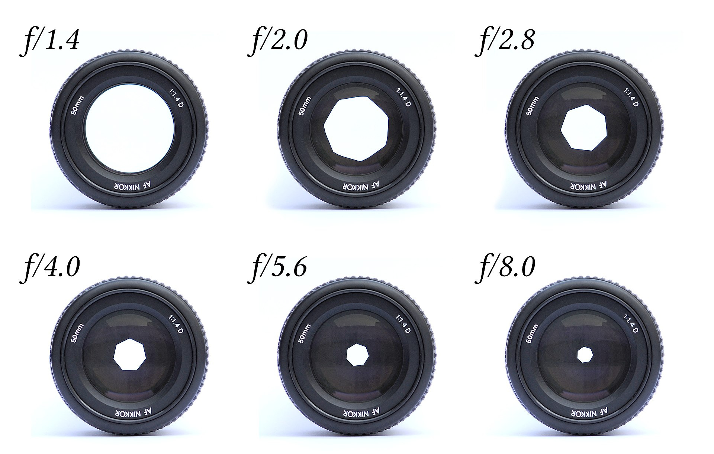
</div>
</div>
---

```yaml
hideInToc: true
```
## Aperture
<div grid="~ cols-2 gap-1">
<div>

- In the right image, the aperture is large and the number is small, which reduces the depth of field and enhances objects close to the camera at the expense of distant ones (background). In the left image, the aperture is smaller and the number is larger, which increases the depth of field and enhances distant objects at the expense of closer ones.
- Expressed as an **f-stop number** (e.g., $f/1.4, f/2.8, f/16$). 
- Because the f-number is a ratio/fraction ($f/\text{number}$), **larger numbers represent smaller physical openings** (greater light blocking).
</div>
<div>
	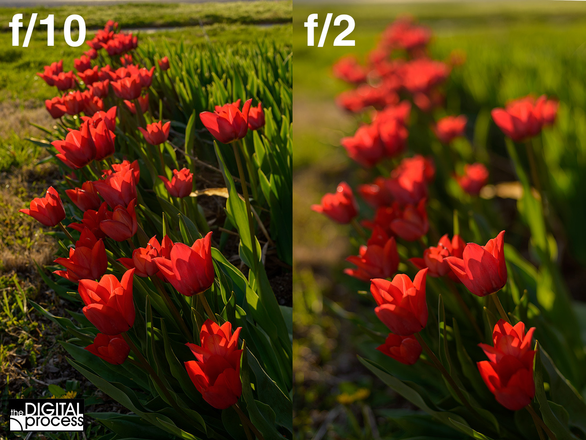
</div>
</div>
---

```yaml
hideInToc: true
```
## Aperture
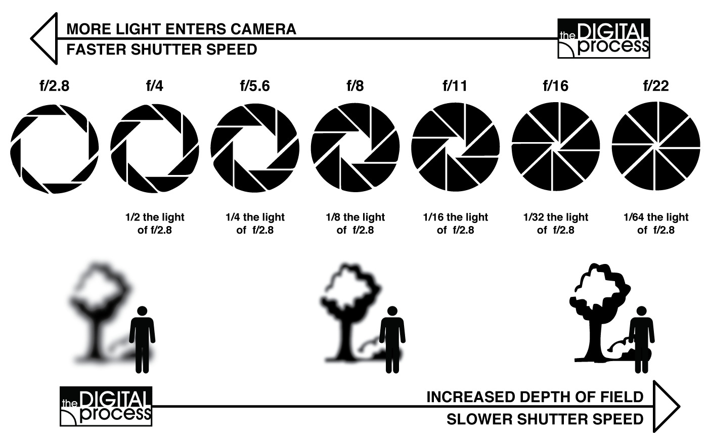
---

```yaml
hideInToc: true
```
## ISO
- This value represents the sensor’s sensitivity to light. The higher the number, the higher the sensitivity. However, high values cause noise to appear in the image.
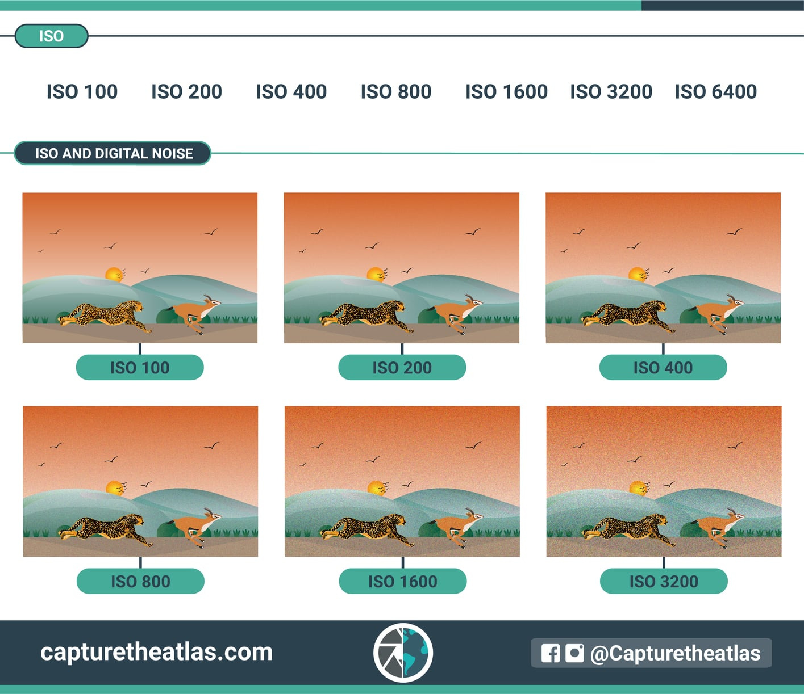
---

```yaml
hideInToc: true
```
## Shutter Speed
- This value represents the time it takes for the shutter in older cameras to close after pressing the capture button.
- In other words, it represents the time the camera takes to capture the image after pressing the button and starting to collect colors from the sensor.
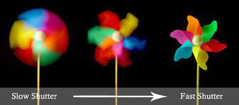
---
 
```yaml
hideInToc: true
```
## Why is it important?
- Simply put, we must balance the four parameters to achieve the best possible image.
- A good image requires minimal preparation and carries a large amount of useful information, which means fewer processing steps are needed.

| Parameter         | Primary Function               | Secondary Visual Effect          |     |
| :---------------- | :----------------------------- | :------------------------------- | --- |
| **Sensor Size**   | Photosite light-gathering area | Base Signal-to-Noise Ratio (SNR) |     |
| **Aperture**      | Lens opening area              | Depth of field (Background blur) |     |
| **Shutter Speed** | Exposure duration              | Motion blur vs. Frozen action    |     |
| **ISO**           | Signal amplification           | Sensor grain / Digital noise     |     |

 > **Goal:** Capturing a well-balanced exposure at acquisition ensures maximum optical signal information and minimizes the need for heavy digital post-processing steps.

---

# Basic Image Operation
- There are multiple operation can be applied to digital image:

	A- **Basic Operations:** Addition, Multiply,Divide, Subtract
	
	B- **Filter Operations:** How to apply various filters (lowpass, highpass, bandpass)
	
	C- **Histogram Operation:** Changing the histogram to make the image better
---

```yaml
hideInToc: true
```
## A- Basic Operations
### 1- Addition
- We can add value to images, and images to images
- When we add values (scalar, single value) we change the color, but that depends on the color system used
	- In RGB Color System, if the same value added to all channels, we increase the lightness in the image
	- In HSV Color System, the effect depends on the channel, hue will change the color, saturation will increase the saturation, while value will make the color lighter
	- In the other color systems (L\*A\*B\*, YUV, Y\`CbCr)  the effects are similar to HSV (because it separates the color value from other components)
---

```yaml
hideInToc: true
```
## A- Basic Operations
### 1- Addition
- In this image we show adding a scalar (single value) to all channels in RGB image
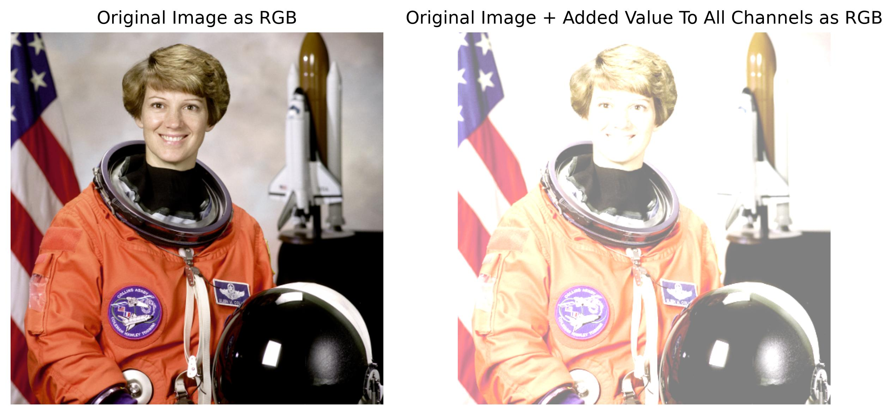
---

```yaml
hideInToc: true
```
## A- Basic Operations
### 1- Addition
- In this image we show adding a scalar (single value) to red channel only in RGB image
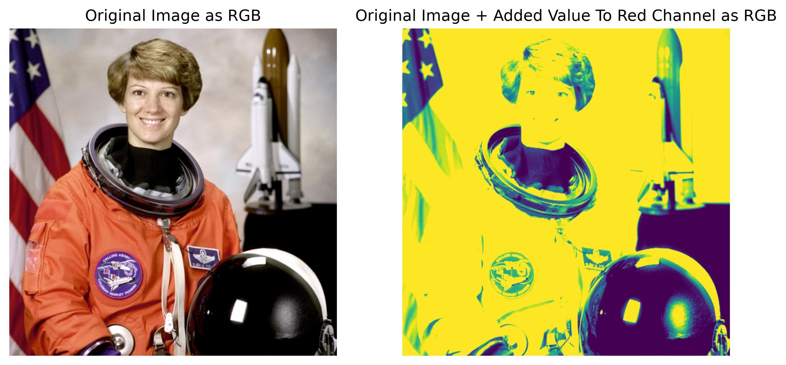
---

```yaml
hideInToc: true
```
## A- Basic Operations
### 1- Addition
- In this image we show adding a scalar (single value) to hue channel only in HSV image
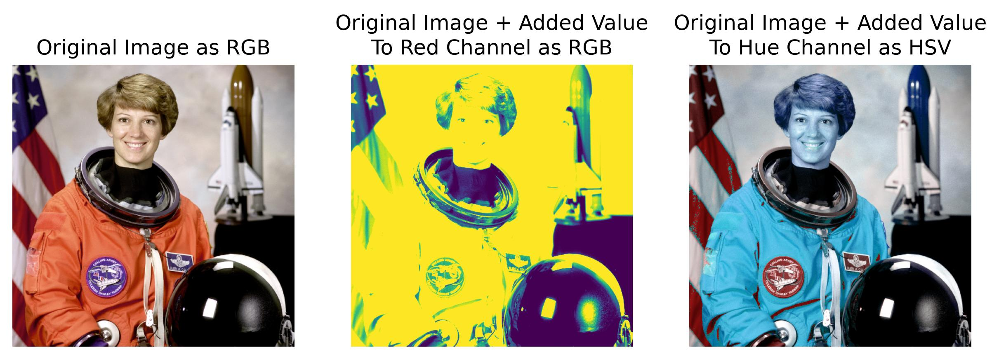
---

```yaml
hideInToc: true
```
## A- Basic Operations
### 1- Addition
- In this image we show adding a scalar (single value) to value channel only in HSV image
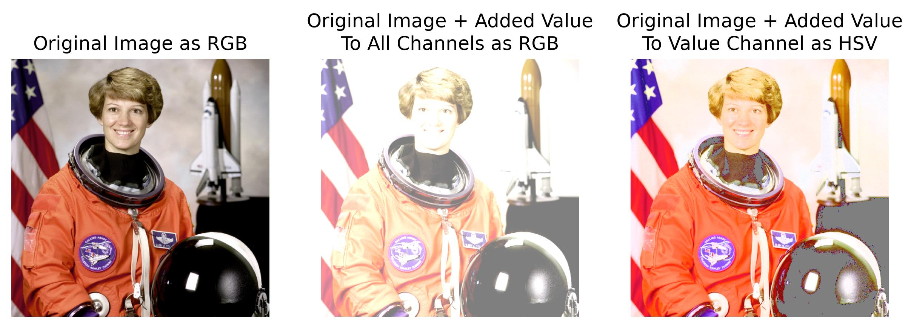
---

```yaml
hideInToc: true
```
## A- Basic Operations
### 1- Addition
- What would happen of added image to image?
- No More Black
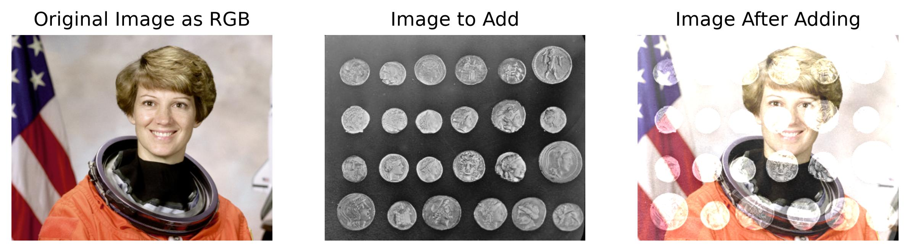
- Notice how the black background is gone? Simple, black is represented as 0, adding any number to 0 is the same number
---

```yaml
hideInToc: true
```
## A- Basic Operations
### 2- Multiplication
- We can multiply value to images, and images to images
- When we multiply values (scalar, single value) we change the color at faster rate than addition, but that depends on the color system used
	- In RGB Color System, if the same value multiplied to all channels, we increase the lightness in the image
	- In HSV Color System, the effect depends on the channel, hue will change the color, saturation will increase the saturation, while value will make the color lighter
	- In the other color systems (L\*A\*B\*, YUV, Y\`CbCr)  the effects are similar to HSV (because it separates the color value from other components)
---

```yaml
hideInToc: true
```
## A- Basic Operations
### 2- Multiplication
- In this image we show multiplying all channels by a scalar (single value) in RGB image
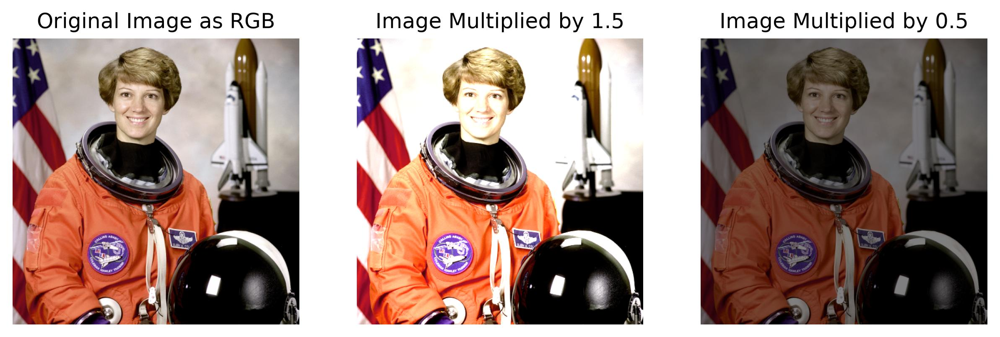
---

```yaml
hideInToc: true
```
## A- Basic Operations
### 2- Multiplication
- In this image we show multiplying red channel by a scalar (single value) only in RGB image
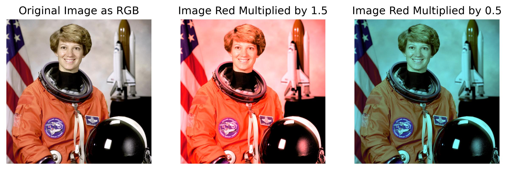
---

```yaml
hideInToc: true
```
## A- Basic Operations
### 2- Multiplication
- In this image we show multiplying hue channel only in HSV image by a scalar value
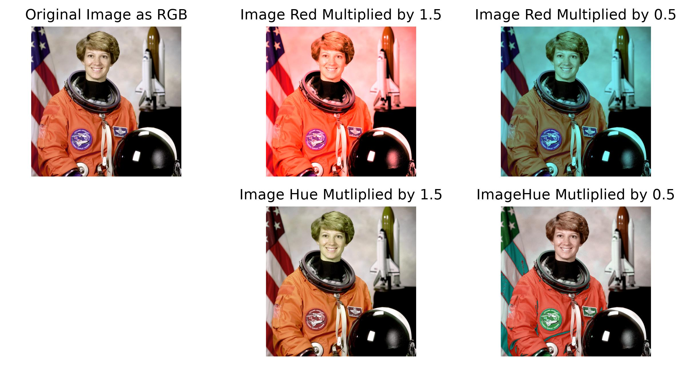
---

```yaml
hideInToc: true
```
## A- Basic Operations
### 2- Multiplication
- In this image we show multiplying value channel only in HSV image by a scalar value
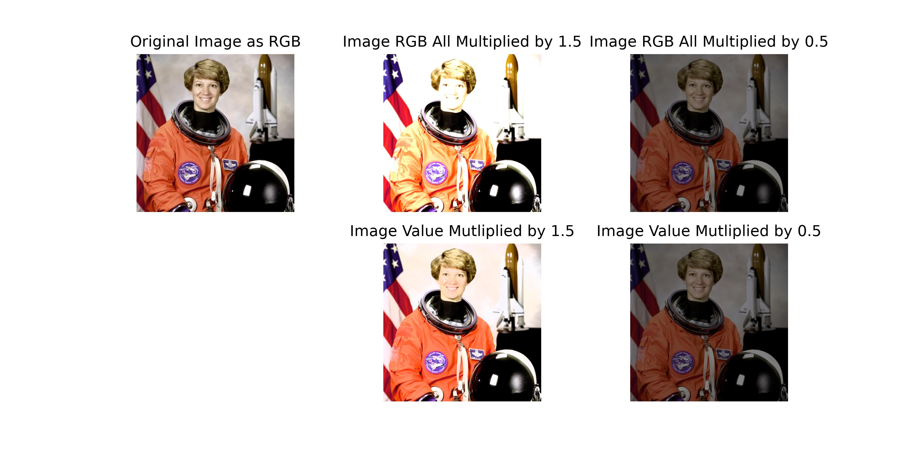
---

```yaml
hideInToc: true
```
## A- Basic Operations
### 2- Multiplication
- What would happen of multiply image by image?
- No More White
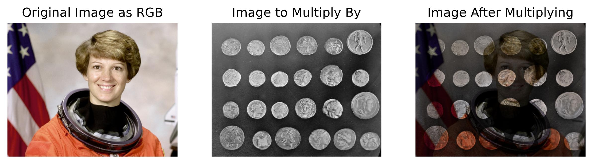
- Notice how the white is almost gone? Remember white is 1, any number times 1 is the same number, while the black(0) persists because black is 0 and any number times 0 is 0
---

```yaml
hideInToc: true
```
## A- Basic Operations
- For subtraction and division same as addition and multiplication but with reverse effect
- What do we learn? It is really easy to play with images, also:
	- In RGB to change the lighting we need to change all channels at once (not necessarily by the same value)
	- In HSV changing the lighting is simpler as we only change the Value channel
	- We can change the redness, greeness and blueness easily in RGB, it a bit more difficult in HSV
	- We can easily change the saturation in HSV
	- In general, color systems which represents the color in different component from lightness gives more freedom in changing that lightness, while RGB (and similar color based color systems) gives more control over individual colors
---

```yaml
hideInToc: true
```
## B- Filter Operations
- What are filters?
	- In Digital Signal Processing (DSP), filters are tools, hardware circuits, or software algorithms that selectively allow certain frequencies of a signal to pass through while suppressing (attenuating) others.
- They are the following type of filters:
	- Low pass filters: allows passing frequencies below certain threshold (cutoff frequency)
	- High pass filters: allows passing frequencies above certain threshold (cutoff frequency)
	- Band pass filters: allows passing frequencies inside a certain range
	- Band pass filters: allows passing frequencies outside a certain range
---

```yaml
hideInToc: true
```
## B- Filter Operations
- In digital Image Processing, the same definition of filters applies, however, in common programs used by non-professionals, the word filter usually describes a set of predefined effects (which might includes actual filtering, color modification and others) that are applied to image to achieve certain artistic style
- You can see these ```filters``` in Instagram and Camera applications, they might include:
	- **Actual Spatial/Frequency Filters:** Adding subtle edge detection or line isolation to create a "pencil sketch" effect, or adding a high-pass sharpen filter to enhance facial features.  
	- **Color System Modifications:** Adjusting temperature, tint, brightness, or saturation (e.g., shifting RGB channels to create a warm, vintage look).	    
	- **Lookup Tables (LUTs):** Re-mapping specific input colors to completely new output colors to emulate distinct film stock or cinematic color grading.	    
	- **Overlays & Textures:** Adding grain, light leaks, vignettes, or blur masks (like tilt-shift or portrait mode bokeh).
> **IN THIS COURSE THE WORD FILTER WILL REFER TO THE SCIENTIFIC AND ACADEMIC DEFINITION AS DESCRIBED BY DIGITAL SIGNAL PROCESSING**

---

```yaml
hideInToc: true
```
## B- Filter Operations
- To apply filters we use the convolution operation, more accurately correlation operation
- More details about said operation we explained in the next lecture
- As for filters, we learn about the following:
	- Gaussian, Mean and Median: Low pass filters
	- Laplace, Sobel, Prewitt: High pass filters
	- DoG & LoG: Band pass filters

---

```yaml
hideInToc: true
```
## B- Filter Operations
<div grid="~ cols-2 gap-1">
<div>

- **Gaussian:** It is a low-pass filter that follows the Gaussian mathematical equation, usually used to reduce Gaussian noise from image
- This is a linear filter, meaning it is applied on the image using convolution
> More about noise in the next lecture
$$
f(x,y)=A e^{-(\frac{(x-x_0)^2}{2\sigma^2_x}+\frac{(y-y_0)^2}{2\sigma^2_y})}
$$
</div>
<div>
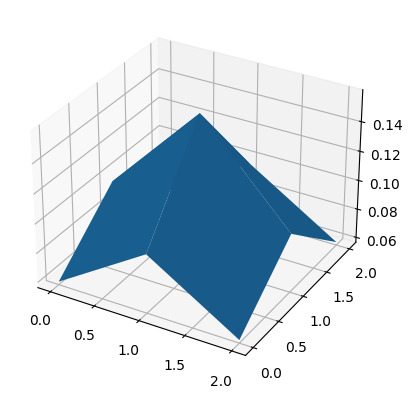
</div>
</div>
---

```yaml
hideInToc: true
```
## B- Filter Operations
- **Median Filter:** It is a non-linear filter, meaning it doesn't apply to image using **convolution**, it is more like an algorithm used to remove extreme values in certain range values
- It works using the following steps:
	- Identify the pixel on which we would like to apply the filter to
	- Define the neighborhood around that pixel (for example, a $3 \times 3$ grid containing the 8 surrounding neighboring pixels plus the center pixel hence 8-neighborhood).
	- Arrange the values in ascending order
	- The value in the center (middle) is the new value of said pixel
	- Move to next pixel until we finished the image
- This filter is very good at removing/reducing extreme irregular values (highest and lowest) which is usually described as salt & pepper noise
---

```yaml
hideInToc: true
```
## B- Filter Operations
- **Prewitt:** It is a set of linear high pass filters, used to detect horizontal and vertical edges in images
- Applying the following filters using convulsion will result in 2 images, one for vertical and one for horizontal edges
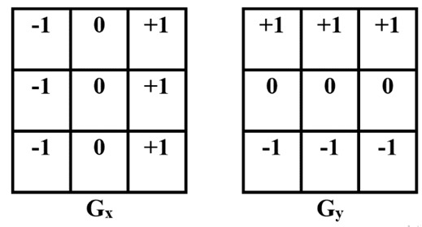
- Ok doc, how combine both resulting image (also called filter responses) into a single image?
- Finally, we get to use that theorem from middle school, the **Pythagorean Theorem
---

```yaml
hideInToc: true
```
## B- Filter Operations
- **Sobel:** It is a set of linear high pass filters, used to detect horizontal and vertical edges in images
- Similar in everything to Prewitt except in 1 value
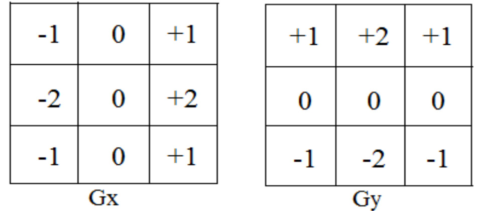
- We even combine the vertical and horizontal edges the same way
---

```yaml
hideInToc: true
```
## B- Filter Operations
<div grid="~ cols-2 gap-4">
<div>

- **Laplace:** A linear single filter used to detect edges (high pass filter) in all directions in the image
- This filter intensity is variable (size is usually 3x3 unless we use LoG), can be changed (with limitation) unlike Sobel and Prewitt which are fixed
- More explanation will be provided in the next lecture
</div>
<div>
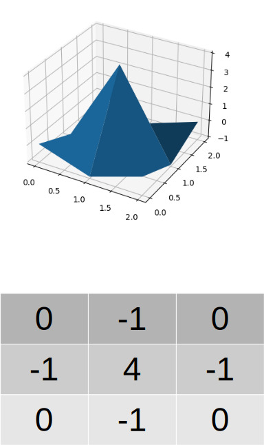
</div>
</div>
---

```yaml
hideInToc: true
```
## B- Filter Operations
- While the previous filters were either high pass or low pass, LoG and DoG are band pass
- LoG first applies Gaussian filter on the image then applies Laplace filter to achieve band pass
- DoG applies 2 Gaussian filters on the image with different intensities to achieve band pass
---

```yaml
hideInToc: true
```
## B- Filter Operations
- **LoG (Simplified)**
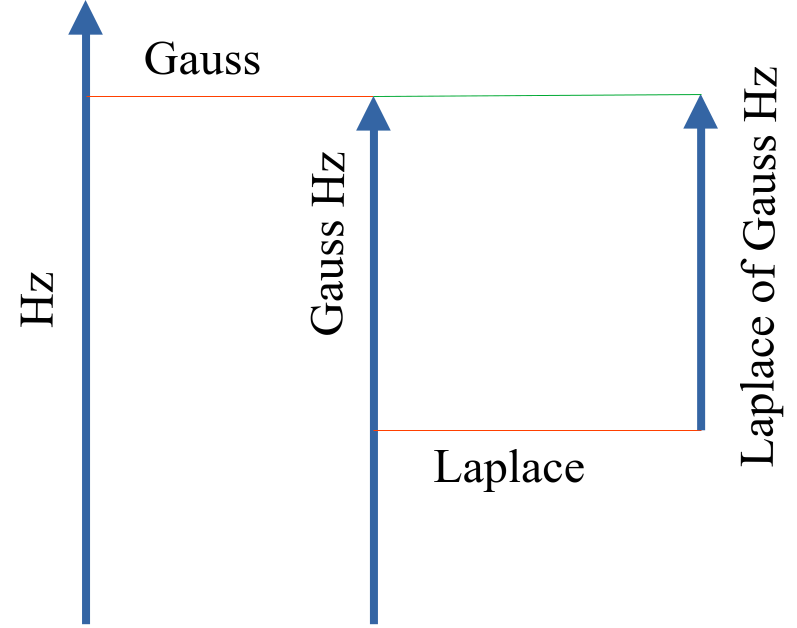
---

```yaml
hideInToc: true
```
## B- Filter Operations
- **DoG (Simplified)**
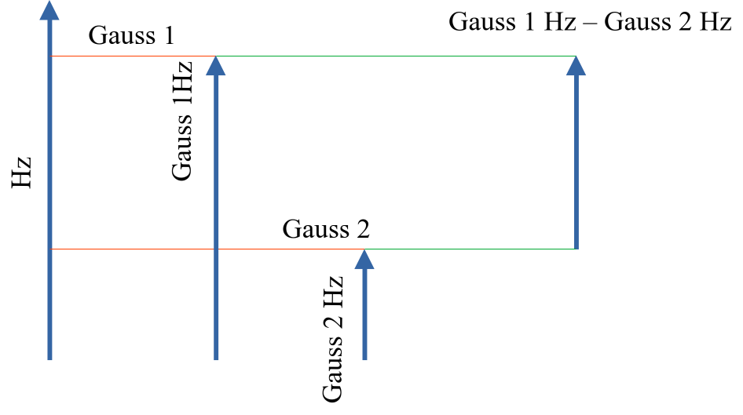
---

```yaml
hideInToc: true
```
## C- Histogram Operations
- To understand histogram operations, we need to understand contrast
- Contrast is the difference in brightness and/or color that makes an object distinguishable.
- To examine contrast, we use a histogram, which shows the frequency of each color level.
- We demonstrate this with a grayscale image (if there is more than one channel, there is a separate histogram for each channel). Values must be integers to simplify calculations.
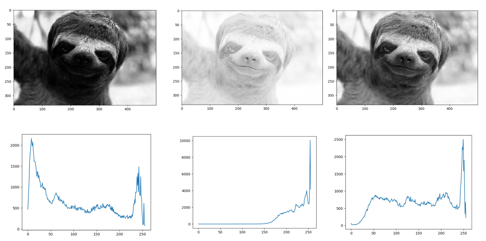
---

```yaml
hideInToc: true
```
## C- Histogram Operations
- When dealing with histograms, it preferred to have integer data type representing the color, as it requires discretization
- We can use floating point, but it requires specifying the number of bins (colors) per channel in order to calculate correctly
- Modifying lighting will change the histogram, when we increase the lighting - specially in RGB color - it will appear as we are shifting the histogram to the right (left when reducing lighting)
- Other operations includes stretching a histogram, making it more spread, increasing overall contrast, but it re-spaces existing values.