# Computer Vision
## Lecture 2  
### Edge Detection

---

```yaml
hideInToc: true
```
# Table of Conent
<toc maxDepth="1"/>
---

# What is Edge?
- When we say edge we don't mean borders of the image
- We mean the location of sudden change between colors, that is the edge
- Edges correspond to high frequencies in images
- We can see it by understanding Fourier transformation
	- This is a transformation that converts information from temporal domain (the normal domain) to frequency domain
	- The first component (value) of the resulting transformation is the DC component containing most information in the signal
	- The rest of the components represent the frequencies in increasing order (further away from the DC component the higher the frequency)
---

# Fourier Transformation
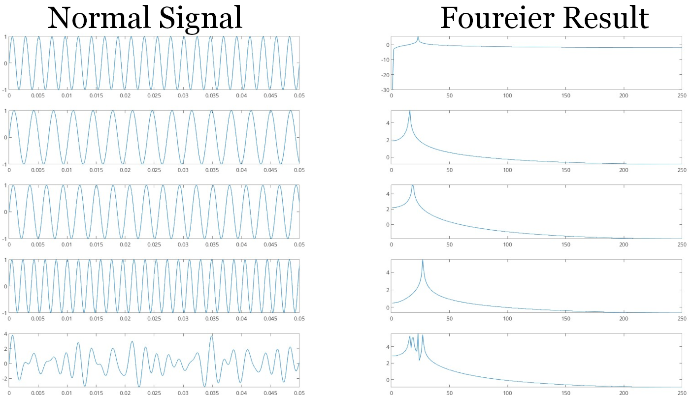

---

```yaml
hideInToc: true
```
# Fourier Transformation
- Fourier Transformation is a mathematical transformation in which we convert a signal from the temporal domain to the frequency domain
- In the temporal domain we acquire the value of a signal
- In the frequency domain we acquire the frequency of signal
	- As shown in the previous slide the bottom signal and its Fourier result is a summation of all the above signals
	- As a result we understand the frequency components of a signal, not to mention we can remove a frequency from the signal by setting the corresponding value in Fourier result to 0

---

```yaml
hideInToc: true
```

# Fourier Transformation
## Fast Fourier Transformation
- The story about fast Fourier transformation is based on strict deadlines, nuclear weapons, USSR and USA
- First thing first:
	- We are not dealing with Fourier transformation, we are dealing with discreet Fourier transformation
	- What is the different? simply put, the main operation in FT is integration, in DFT we approximate the integration with sum operation, and we work with measuring values not a function

<div grid="~ cols-2">

<div class="text-center" style="font-size: 0.9rem">

FT
$$
X(f) = \int_{-\infty}^{\infty} x(t) e^{-j 2 \pi f t} \, dt
$$
Inverse FT
$$
x(t) = \int_{-\infty}^{\infty} X(f) e^{j 2 \pi f t} \, df
$$
</div>

<div class="text-center" style="font-size: 0.9rem">

DFT
$$
X(k) = \sum_{n=0}^{N-1} x(n) e^\frac{-j 2\pi kn}{N}
$$
Inverse DFT
$$
x(n) = \frac{1}{N} \sum_{k=0}^{N-1} X(k) e^\frac{j 2\pi kn}{N}
$$
</div>

</div>

---

```yaml
hideInToc: true
```
# Fourier Transformation
## Fast Fourier Transformation
- We are dealing with images, a 2D signal, therefore we use 2D DFT:
$$
F(u, v) =
\sum_{x=0}^{M-1} \sum_{y=0}^{N-1}
f(x, y)\, e^{(-j 2\pi \left( \frac{ux}{M} + \frac{vy}{N} \right))}
$$
- While the inverse is:
$$
f(x, y) =
\frac{1}{MN}
\sum_{u=0}^{M-1} \sum_{v=0}^{N-1}
F(u, v)\, e^{(j 2\pi \left( \frac{ux}{M} + \frac{vy}{N} \right))}
$$
---

```yaml
hideInToc: true
```
# Fourier Transformation
## Fast Fourier Transformation
- The problem with both FT and DFT is the calculation speed
- The story of calculating DFT as fast as possible is based in the treaties signed between USSR and USA to ban testing of new nuclear weapons
- We can test nuclear weapons on land, in space, in sea and underground.
- All of them are easily detectable but the underground is not
	- It creates a seismic events
	- The telltale of an underground explosion is seismic events recorded using various measurement tools 
	- The problem was how to uniquely identify legit seismic events (The result of an earthquake or a volcano) and the result of nuclear testing
	- It in the frequencies, which is where DFT is king
---

```yaml
hideInToc: true
```
# Fourier Transformation
## Fast Fourier Transformation
- The problem was simple, calculations took too long to be done
- We needed to go faster.
- Unfortunately, the DFT algorithm was done after the signing of nuclear test ban treaty
	- Therefore, all but underground testing of nuclear weapons is banned
- The FFT is about divide and conquer
	- Basically it works but splitting the points into 2 smaller sets
	- We continue until we reach 2 values only, apply then return up until we calculate the entire point set
---

```yaml
hideInToc: true
```
# Fourier Transformation
## FT & Edges

<div grid="~ cols-2">
<div>

- There are 2 images, goofy and the degraded goofy, with FTs below each.
- Notice that both suffer from edge effects as evidenced by the strong vertical line through the center.
- The major effect to notice is that in the transform of the degraded goofy the high frequencies in the horizontal direction have been significantly attenuated.
- This is due to the fact that the degraded image was formed by smoothing only in the horizontal direction.

</div>
<div>
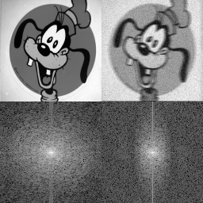
</div>
</div>
---

```yaml
hideInToc: true
```
# Fourier Transformation
## FT & Edges

<div grid="~ cols-2">
<div>

- Also, if you look carefully you can see that the degraded goofy has a slightly larger background noise level at high frequencies.
- Notice also that it is difficult to make much sense out of the low frequency information. This is typical of real life images.

</div>
<div>

</div>
</div>
---

```yaml
hideInToc: true
```
# Fourier Transformation
- To summarize:
	- FT allows us to understand frequencies in signals
	- Images are 2D signals therefore they can by analyzed by 2D Fourier Transformation
	- This can be very helpful when extracting information about the image, including but limited to edge detection and noise cancellation
---

```yaml
hideInToc: true
```
# Convolution and Correlation
- 2 very important operations in Digital Signal Processing and by extension Digital Image Processing
- Both of them calculate the amount of similarities between 2 different signals
- The higher the result the more similar the signals
- P.S.: In academic circles, when we are talking about Image Processing Convolution is the **same** as Correlation, but when talking about Signal Processing Convolution is **different** from Correlation
---

```yaml
hideInToc: true
```
# Convolution and Correlation
## The Math Behind It
- When talking about these 2 concepts we need to have 2 signals:
	- A big signal, let's call it the source signal **S**
	- A small signal, let's call it the mask signal **M** (or **K**ernel)
	- What we want to do is checking the existence of M in **all possible locations inside** S
		- Where M exists (approx.) the value of S remains high, but when it doesn't the value is 0 or close to it
		- In mathematical notion, the mask signal goes from \[-a,+a\] in indecies
<div grid="~ cols-2 gap-10">
<div class="text-center">

Convolution
$$
S(x,y) \ast M = \sum_{u=-a}^{u=a}\sum_{v=-b}^{v=b}M(u,v)S(x-u,y-v)
$$
</div>
<div class="text-center">

Correlation
$$
S(x,y) \ast M = \sum_{u=-a}^{u=a}\sum_{v=-b}^{v=b}M(u,v)S(x+u,y+v)
$$
</div>
</div>
---

```yaml
hideInToc: true
```
# Convolution and Correlation
## The Math Behind It
- Applying Correlation and Convolution on a signals
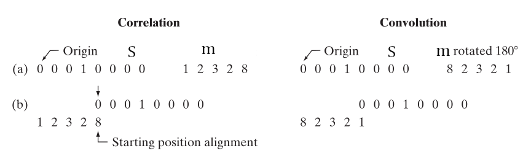
- Usually the filters in digital image processing are symmetric, hence correlation = convolution
---

```yaml
hideInToc: true
```
# Convolution and Correlation
- What is so important about these 2 operations?
- What if I told you applying filters to images depends on correlation! Interested, right?
- Simply put filters are simple signals, when correlating with an image (or any other signal for that matter) they allow values similar to them to stay, while ones different are removed
- We said that noise is high frequency, right? By applying low pass filter (e.g. Gauss) we allow values with neighborhoods reaching to 1 to stay, while ones reaching 0 to be removed
	- Remember, it is not set in stone, but low pass filters usually has a sum value of 1, while high pass have sum value of 0 (approx.)
- Meaning when the neighborhoods of similar values, it is full of low frequencies, while the neighborhoods of widely different values is full of high frequencies.
---

```yaml
hideInToc: true
```

# Convolution and Correlation
## Applying Filters
- When A filter (kernel/mask) get applied to image, we apply on each pixel independently
- Each pixel has a neighborhood of pixels which are taken into consideration during the application process
- Let's say we want to apply the filter k on the image S at the selected pixel (the neighborhood is the red square)
<div grid="~ cols-2">
<div>
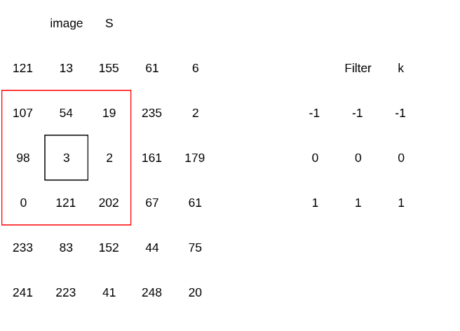
</div>
<div>

$$
new PixelValue= -1\times107+-1\times54+-1\times19+
\newline
0\times98+0\times3+0\times2+
\newline
1\times0+1\times121+202\times1
$$
</div>
</div>

---

```yaml
hideInToc: true
```
# Convolution and Correlation
## Applying Filters
<div grid="~ cols-2">
<div>
	
- What would happen if don't have a big enough neighborhood to apply a filter?
- How to deal with situation?
- The solution is simple we add values
- This done usually through padding
	- We usually add zeros to around the image
	- The amount of zeros added on each size amounts to the $\frac{size~of~kernel}{2}$
	- Now we have a bigger image
	- We apply the filter but on the entire new image
	- Only on a the original image
</div>
<div>
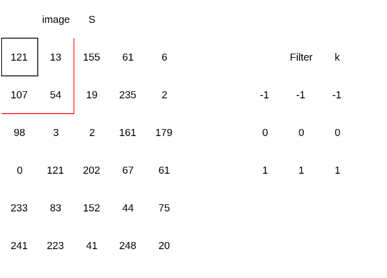
</div>
</div>
---

```yaml
hideInToc: true
```
# Convolution and Correlation
## Applying Filters
<div grid="~ cols-2">
<div>
	
- Now we apply the filter but only calculate at the original image
- The padded values provides the ability to calculate the filter response for edge pixels
- There are few other methods:
	- We can pad other values, but 0 is the most used
	- Reflection
	- Rotation
- But 0 padding is the most used
</div>
<div>
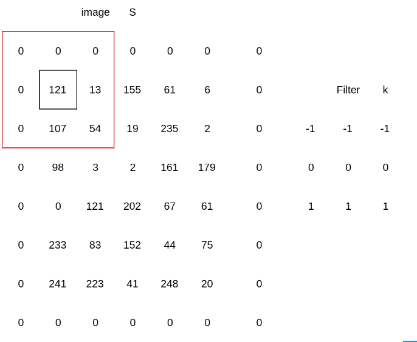
</div>
</div>
---

# Image Gradient (Derivative)
- Images are digital signals
- Digital signals are signals
- Signals are functions
- Functions have derivative
- Just like any other function, it has a derivative
- But wait a minute, we don't know the formula for the image, how can we derive the function?
- In case we don't have a formula, we simply subtract

| x                 | 0   | 1   | 2   | 3   | 4   | 5   | 6   | 7    | 8   | 9   |
| ----------------- | --- | --- | --- | --- | --- | --- | --- | ---- | --- | --- |
| f(x)              | 20  | 30  | 10  | 14  | 29  | 14  | 200 | 30   | 19  | 10  |
| f'(x)=f(x)-f(x-1) |     | 10  | -20 | 4   | 15  | -15 | 186 | -170 | 11  | -9  |

---

```yaml
hideInToc: true
```
# Image Gradient (Derivative)
- If there are no big changes between neighboring pixels, the derivative is reaching to 0
- If there are big changes, the derivative will show in difference as bright spot
- In other words, when 2 neighboring pixels have a big difference in value, the change is obvious and shows
- This is the same as applying high pass filter
- We mentioned earlier that **high-frequency filters** help us extract **edges**.
- The main reason is that they help compute the **first and second derivatives** of images.
  In this case, we preserve the **large differences between image pixels**, and these differences **represent the edges**.
---

```yaml
hideInToc: true
```

# Image Gradient (Derivative)
- Sobel, Prewitt and Scharr calculate the first derivative
- Laplace calculate the second derivative
<div grid="~ cols-3">
<div class="text-center">

Prewitt
$$
G_x =
\begin{bmatrix}
-1 & 0 & 1 \\
-1 & 0 & 1 \\
-1 & 0 & 1
\end{bmatrix}
\quad
\newline
G_y =
\begin{bmatrix}
 1 &  1 &  1 \\
 0 &  0 &  0 \\
-1 & -1 & -1
\end{bmatrix}
$$
</div>
<div class="text-center">

Sobel
$$
G_x =
\begin{bmatrix}
-1 & 0 & 1 \\
-2 & 0 & 2 \\
-1 & 0 & 1
\end{bmatrix}
\quad
\newline
G_y =
\begin{bmatrix}
 1 &  2 &  1 \\
 0 &  0 &  0 \\
-1 & -2 & -1
\end{bmatrix}
$$
</div>
<div class="text-center">

Scharr
$$
G_x =
\begin{bmatrix}
-3 & 0 & 3 \\
-10 & 0 & 10 \\
-3 & 0 & 3
\end{bmatrix}
\quad
\newline
\newline
G_y =
\begin{bmatrix}
 3 & 10 & 3 \\
 0 & 0 & 0 \\
-3 & -10 & -3
\end{bmatrix}
$$
</div>
</div>

---

```yaml
hideInToc: true
```
# Image Gradient (Derivative)
## Still It Makes No Sense
- Still need a lot of explanation
- Let's take a deep dive using the first row fo $G_x$ of Prewitt: $[-1,0,+1]$
$$
R(x,y)=I(x-1,y)\times-1 + I(x,y)\times0+I(x+1,y)\times1
\newline\newline
R(x,y)=I(x+1,y)-I(x-1,y)
$$
- The same can be said for $G_y$ 
- This is a modification of the standard derivative formula (first derivative)
---

```yaml
hideInToc: true
```
# Image Gradient (Derivative)
## Still It Makes No Sense
- What about Laplace?
- Let's take the following Laplace 1D filter $[-1,2,-1]$
$$
R(x,y)=I(x-1,y)\times-1+I(x,y)\times2+I(x+1,y)\times-1
\newline\newline
= 2I(x,y)-I(x-1,y)-I(x+1,y)
\newline
	= (I(x,y)-I(x-1,y))-(I(x+1,y)-I(x,y))
$$
- Which is approximation of the 2nd derivative
---

# What Does This Mean
- Edge detection is a simple derivation of the image
- Filters are modification of the derivative formula to emphasize certain features over others
- But wait a minute, Prewitt Sobel and Scharr have 2 filters, meaning two responses how to make them a one?
	- It is true all of these filters produce 2 images for horizontal edges and vertical edges, in order to make cover all the edges we use super difficult, complex and unprocessable Pythagorean Theorem
$$
R(x,y)=\sqrt{(R_x(x,y))^2+(R_y(x,y))^2}
$$
---

```yaml
hideInToc: true
```
# What Does This Mean
- You said we have a first derivative and a second derivative, what is the difference?
- The first derivative produces thicker edges while the second derivative is more sensative to micro details like thin edges and isolated points (noise)
---

```yaml
hideInToc: true
```
# The results
<div grid="~ cols-2">
<div>
The Image
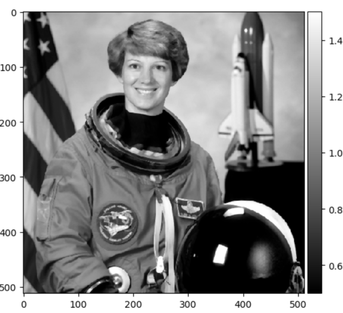
</div>
<div>
Laplace Response
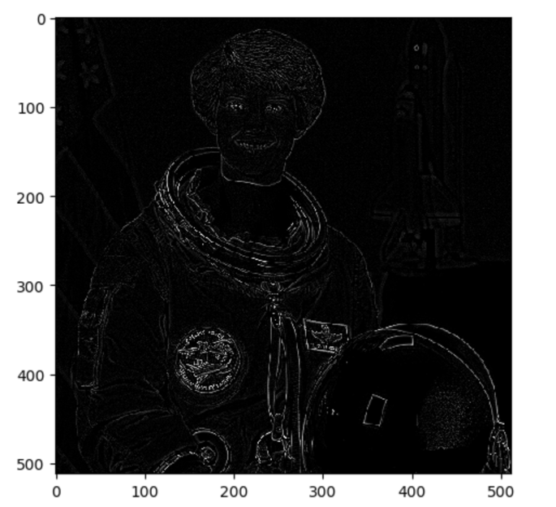
</div>
<div>
Prewitt Response
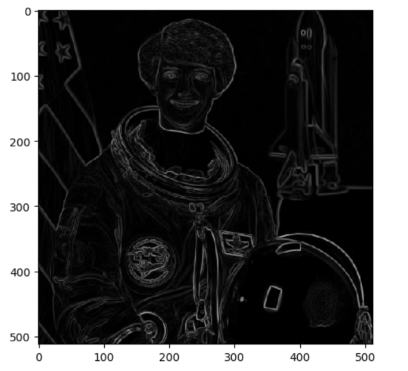
</div>
<div>
Sobel Response
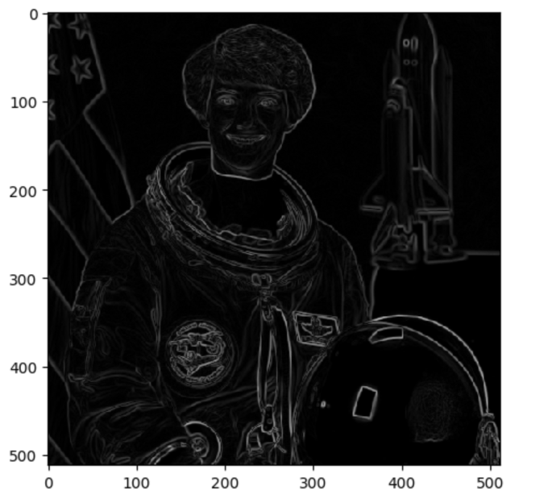
</div>
</div>

---

# Thresholding

- We need to isolate the detected edges, we simply threshold
- Using this we convert from gray scale to binary
- The process is simple:
	- We select a value (threshold)
	- Every thing bigger is white, the rest is black
- How can we choose the threshold?  
	- We can choose the threshold **manually**, **statistically**, or by using **various algorithms**.
	- Is it necessary to have a single threshold for the entire image?  
	- It is **not necessary** to have just one threshold for the image — we can use the concept of **Adaptive Thresholding** or **Multiple Thresholds** to generate a separate threshold for **each pixel** or for **groups of pixels**.
---

```yaml
hideInToc: true
```
## Statistical Threshold
<div grid="~ cols-2">
<div>

- Choosing the threshold **statistically**  
- can be done using **mathematical calculations** such as the **arithmetic mean**,  or by analyzing the **histogram** 
	- where the **largest cluster of pixel values** occurs  
	- Where the **mean value** within that region
</div>
<div>
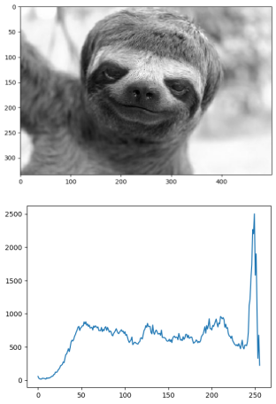
</div>
</div>

---

```yaml
hideInToc: true
```
## Algorithmic Threshold
- Ready-made Algorithms
	- There are several algorithms for selecting the optimal threshold.  
	- The most famous of these is **Otsu's algorithm**.  
	- This algorithm works on the principle of minimizing the variance within the same class (intra-class variance), by maximizing the variance between classes (inter-class variance).  
	- It usually returns a single value representing a global threshold for the entire image.

---

```yaml
hideInToc: true
```
## Multiple/Adaptive Thresholds
- In this case, we can divide the image into several sections  
- Calculate the threshold for each section  
- Apply the resulting threshold to each section
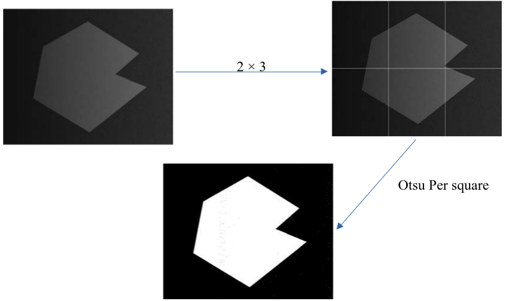
---

# Algorithmic Edge Detection
## Canny Edge Detection
- It is an edge detection algorithm developed in 1986.  
- It works according to the following steps:
	1. Denoise the image using a Gaussian filter.
	2. Detect horizontal and vertical edges using the Sobel operator. 
	3. Compute the overall response and Sobel direction (Intensity Gradient).
	4. Apply Non-Maximum Suppression.
	5. Apply Hysteresis Thresholding

---

```yaml
hideInToc: true
```
# Algorithmic Edge Detection
## Canny Edge Detection
- Compute the overall response and Sobel direction (Intensity Gradient):  
	- We calculate the intensity value of the Sobel operator horizontally and vertically (i.e., the overall response).
$$
G = \sqrt{G_x^2+G_y^2}
$$
	- We calculate the direction using:
$$
	 \theta = arctan(\frac{G_x}{G_y}) 
$$
---

```yaml
hideInToc: true
```
# Algorithmic Edge Detection
## Canny Edge Detection
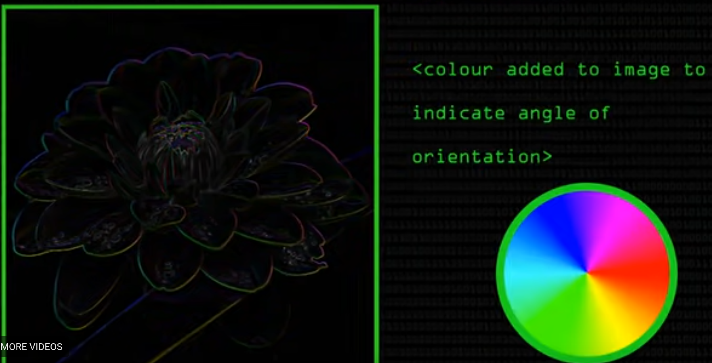

---

```yaml
hideInToc: true
```

# Algorithmic Edge Detection
## Canny Edge Detection
- Apply Non-Maximum Suppression:  
	- Non-Maximum Suppression (NMS) is a technique used to refine the results of a convolution operation. A pixel's value is retained only if it is the maximum value within its local neighborhood (e.g., a 3×33 \times 33×3 window). If the pixel's value is smaller than any of its neighbors, it is suppressed (set to zero)
	- The standard NMS works as follows:
<div grid="~ cols-2 gap-40">
<div>

$$
E =IFF~ ~E >A,B,C,D,F,G,H,I => E~ ~else~0
$$

</div>
<div>
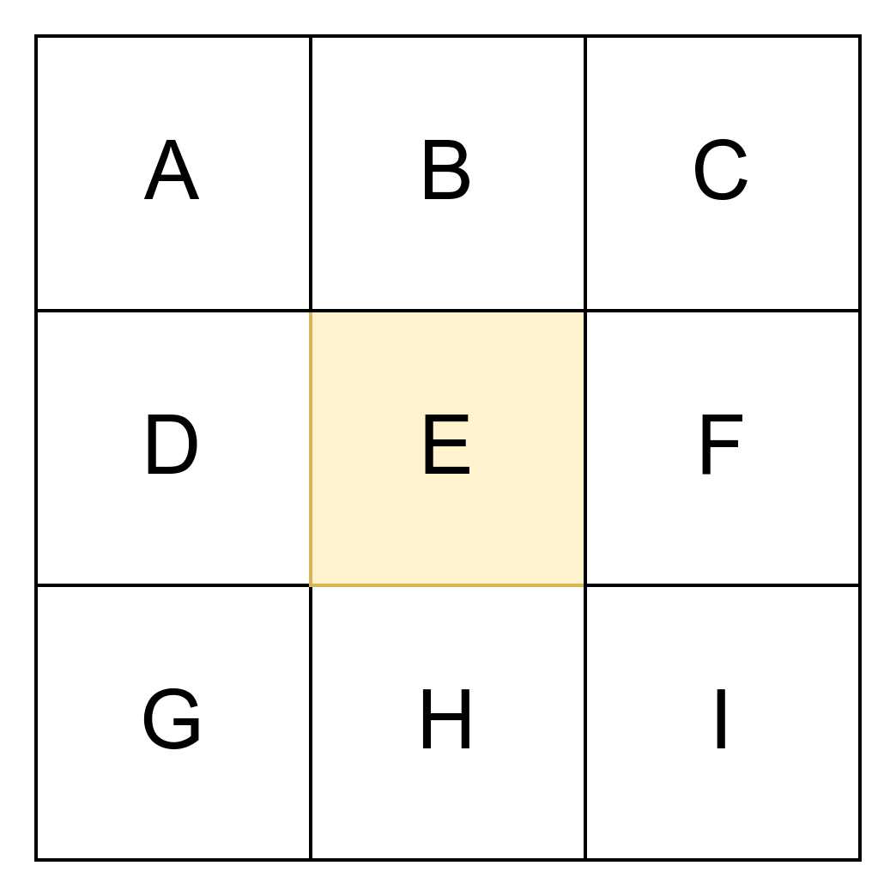
</div>


</div>

---

```yaml
hideInToc: true
```
# Algorithmic Edge Detection
## Canny Edge Detection
- Apply Non-Maximum Suppression:
	- By incorporating the direction info we reduce the number of comparisons
<div grid="~ cols-2">
<div>
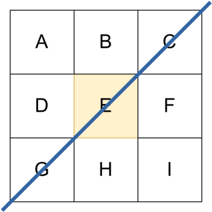
</div>
<div>

- We simply limit the comparison to the element corresponding with the direction
- In our example it is E,C,G only
</div>
</div>

---

```yaml
hideInToc: true
```
# Algorithmic Edge Detection
## Canny Edge Detection
<div grid="~ cols-2">
<div>

- Apply Hysteresis Thresholding:  
	- It relies on two values, **minVal** and **maxVal**.
	- Anything **above maxVal** is considered an edge.
	- Anything **below minVal** is **not an edge**.    
	- For values **between minVal and maxVal**, they are considered edges **only if they are connected to a strong edge** (i.e., a pixel above maxVal).
	- If a pixel in this range is **connected to a strong edge**, it is considered an edge.
Otherwise, it is **ignored**.
</div>
<div>
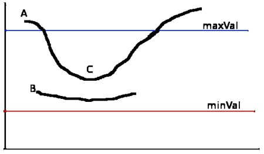
</div>
</div>

---

# BLOB
- Blob detection is a technique in computer vision used to identify regions in an image that differ in properties (such as brightness or color) compared to surrounding regions, often used to detect features like spots, corners, or objects
---

```yaml
hideInToc: true
```
# BLOB
## Laplacian of Gaussian (LoG)
- Principle:
	- Blobs are regions where the image intensity has local extrema  
	- The Laplacian operator highlights areas of rapid intensity change.    
	- To reduce noise, the image is smoothed first with a Gaussian filter, giving the Laplacian of Gaussian.
- Steps:
	1. Smooth the image with a Gaussian of scale $\sigma$:   
		- $L(x,y;σ)=G(x,y;σ)∗I(x,y)$
		- $L(x, y; \sigma) = G(x, y; \sigma) * I(x, y)L(x,y;σ)=G(x,y;σ)∗I(x,y)$
	2.  Find local maxima and minima across space and scale. These correspond to blobs. 
---

```yaml
hideInToc: true
```
# BLOB
## Laplacian of Gaussian (LoG)
- Pros: Accurate detection of blob size and location.
- Cons: Computationally expensive because the Laplacian has to be computed for multiple scales.
---

```yaml
hideInToc: true
```
# BLOB
## Laplacian of Gaussian (LoG)
- The Mexian Hat Shap is the shap of LoG
	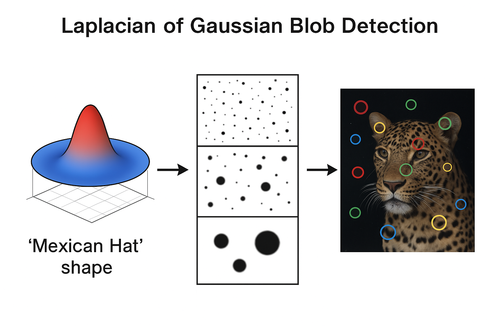
---

```yaml
hideInToc: true
```
# BLOB
## Difference of Gaussian (DoG)
- Principle:
	- DoG approximates LoG but is faster to compute
	- The Laplacian operator highlights areas of rapid intensity change.    
	- To reduce noise, the image is smoothed first with a Gaussian filter, giving the Laplacian of Gaussian.
- Steps:
	1. Smooth the image at two scales $\sigma$ and $k \sigma$ where $k>1$.
	2.  Subtract the smoothed images to get DoG. 
	3. Detect local extrema in space and scale as blob locations.
---

```yaml
hideInToc: true
```
# BLOB
## Difference of Gaussian (DoG)
- Pros:
	- Much faster than LoG.   
	- Used in SIFT feature detection.   
- Cons:
	- Approximation, slightly less accurate than exact LoG.
---

```yaml
hideInToc: true
```
# BLOB
## Difference of Gaussian (DoG)
<div grid="~ cols-2">
<div>
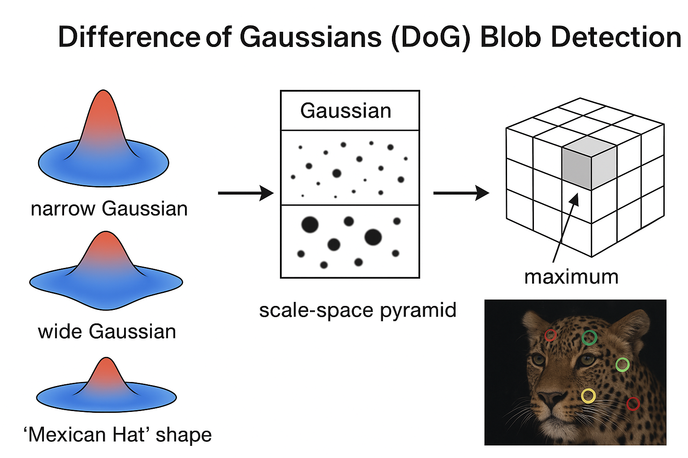
</div>
<div>
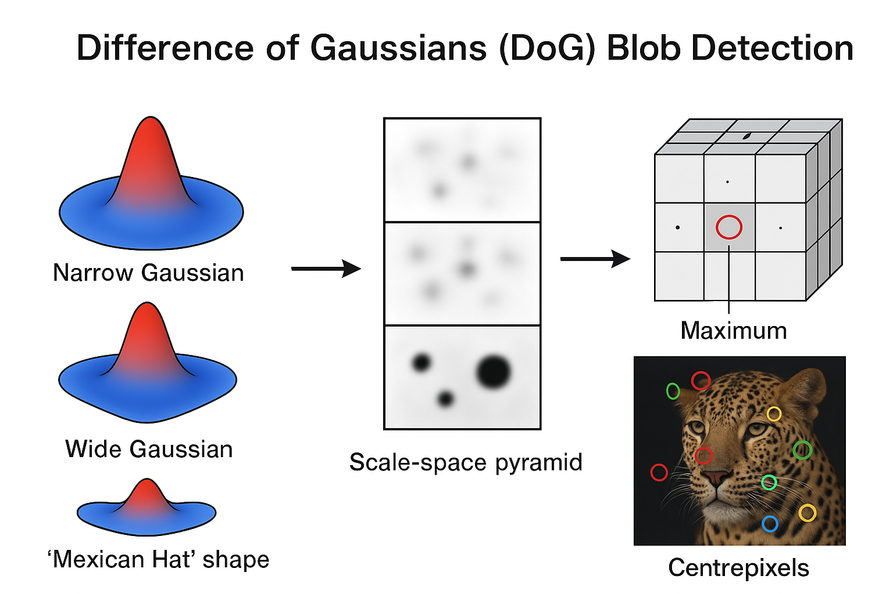
</div>
</div>
---

```yaml
hideInToc: true
```
# BLOB
## Connected Component
- A connected component is a set of pixels in a binary image (or sometimes in a grayscale image after thresholding) that are connected to each other and share similar properties (like intensity or color).
- Essentially, it’s a “blob” or cluster of pixels that can be treated as a single object in the image.
- A connected component is a group of adjacent pixels that are all foreground pixels (usually 1s in a binary image).
- Pixels are considered connected based on a **connectivity criterion**:
	- 4-connectivity: Pixels are connected if they share an edge (up, down, left, right).
	- 8-connectivity: Pixels are connected if they share an edge or a corner (diagonal connections included).
- The method of work:
	- Scan the image and label each connected region with a unique identifier. 
	- All pixels with the same label belong to the same connected component.
---

# Morphology
<div grid="~ cols-2 gap-4"> <div>

- Sometimes when detecting edges we get cases where we have weak edges, extra
edges, and incomplete edges - As we see in the image on the side, the letters
have incomplete edges - Weak Edges happen because two objects are close to each
other, in which situation, sometimes edge detection methods creates a link
between the edges - Extra edges are like spurs or spikes on the original objects
</div> <div>  </div> </div>

---

```yaml
hideInToc: true
```
# Morphology
- We need a method to handle the inconsistencies with edges
- As result we use morphological operations (dilation, erosion, opening and closing)
- These operations are defined as set operations on images:
	- If we are working on binary images, we operate on $Z^2$, (x,y) the result is 0 (black) or 1 (white)
	- If we are working on gray scale images, we operate on $Z^3$, (x,y) the result is the gray scale value
- We use morphology with two types of sets of pixels: objects and structuring elements:
	- Objects are defined as sets of foreground pixels
	- Structuring elements can be specified in terms of both foreground and background pixels. In addition, structuring elements sometimes contain so-called “don’t care” elements, denoted by ×, signifying that the value of that particular element in the SE does not matter

---


```yaml
hideInToc: true
```
# Morphology
<div grid="~ cols-2">
<div>

- The upper line in the image represent the images
	- White pixel represents the background, while the blue ones are the foreground (object)
-  The lower line in the image represent the structure element
 	- White pixel represents the background, while the blue ones are the foreground (object), (no x here) while X represents the "don't care" pixels
</div>
<div>

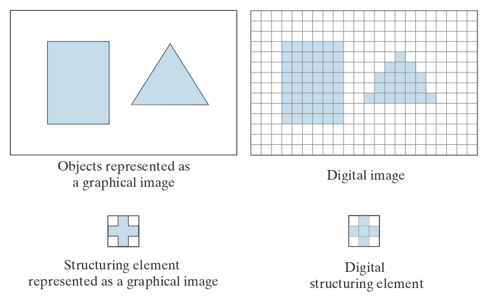
</div>
</div>
---

```yaml
hideInToc: true
```
# Morphology

<div grid="~ cols-2">
<div>

- The example image in the side is a simple morphology operation:
	- The Structuring Element B is all blue (All needed) pixels, meaning we accept the pixel in the center of the structuring element if and only if the all elements around contained foreground information
	- As a result we see the transformation of the object A is being slimmed down, pixels not completely surrounding other pixels
</div>
<div>
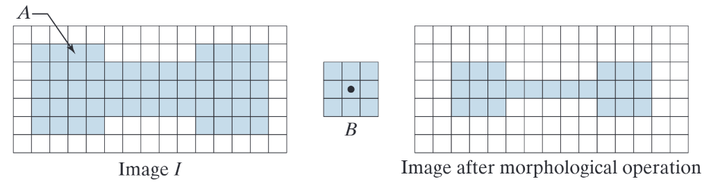
</div>
</div>
---

```yaml
hideInToc: true
```
# Morphology
## Reflection
- Defined by the following equation
$\hat{B}=\{w | w=-b, for~b \in B\}$
- Meaning $\hat{B}(x,y)=B(-x,-y)$
## Translation
- Defined by the following equation
$(B)_z=\{c | c=b+z, for~b \in B\}$
- Meaning $(B)_z(x,y)=B(x+z_1,y+z_2)$
---

```yaml
hideInToc: true
```
# Morphology

An Exmaple

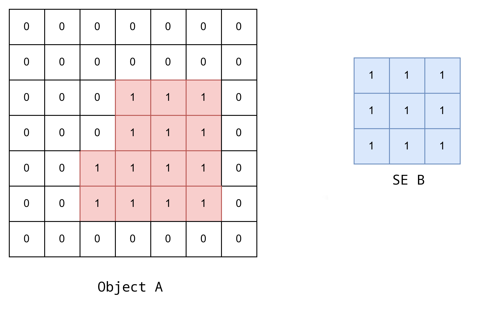
---

```yaml
hideInToc: true
```
# Morphology

An Exmaple

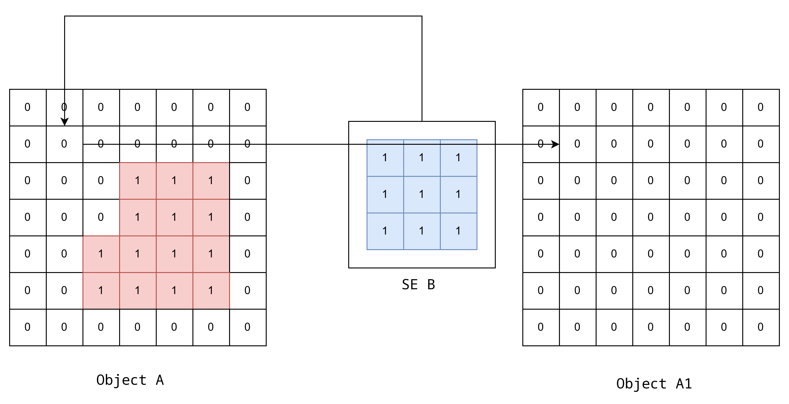
---

```yaml
hideInToc: true
```
# Morphology

An Exmaple


---

```yaml
hideInToc: true
```
# Morphology

An Exmaple


---

```yaml
hideInToc: true
```
# Morphology

An Exmaple

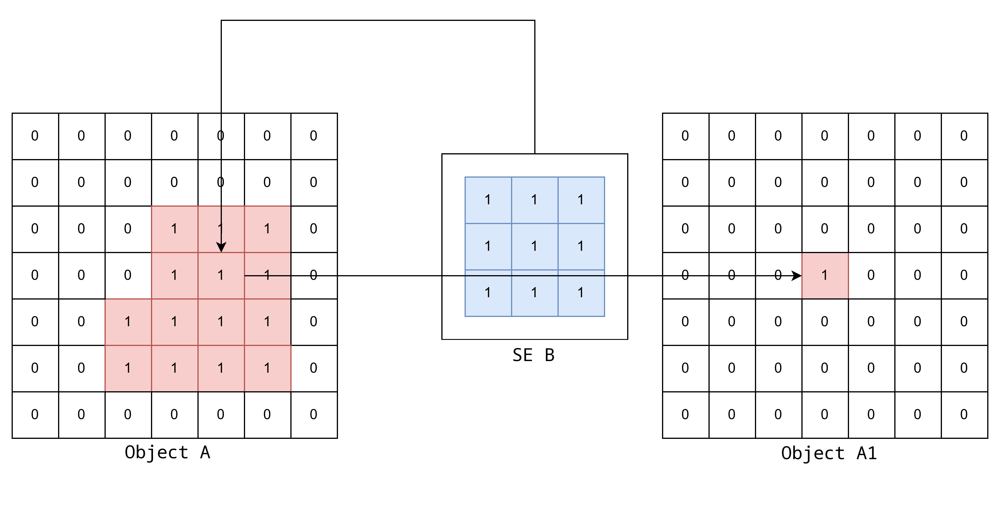
---

```yaml
hideInToc: true
```
# Morphology

An Exmaple

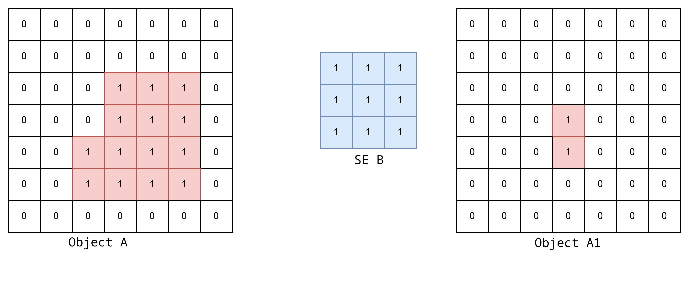
---

```yaml
hideInToc: true
```
# Morphology

A test

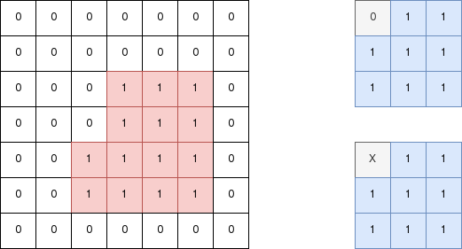
---

```yaml
hideInToc: true
```
# Morphology

A test

<div grid="~ cols-2">
<div>
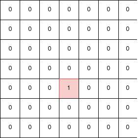
</div>
<div>
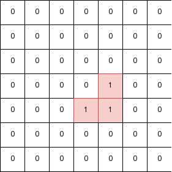
</div>
</div>
---

```yaml
hideInToc: true
```
# Morphology
## Erosion
- Defined by
$A \ominus B~=~\{z | (B)_z~\subseteq~A~ \}$
	- A is the object, B is the structuring elements
- This equation indicates that the erosion of A by B is the set of all points z such that B, when shifted (translated) by z is entirely contained within A. 
- In other words, we generate four images from the object A
- In each one, we shift it up, down, right, and left, then we take the **intersection** of all these images.
- Erosion shrinks an object
---

```yaml
hideInToc: true
```

# Morphology
## Erosion

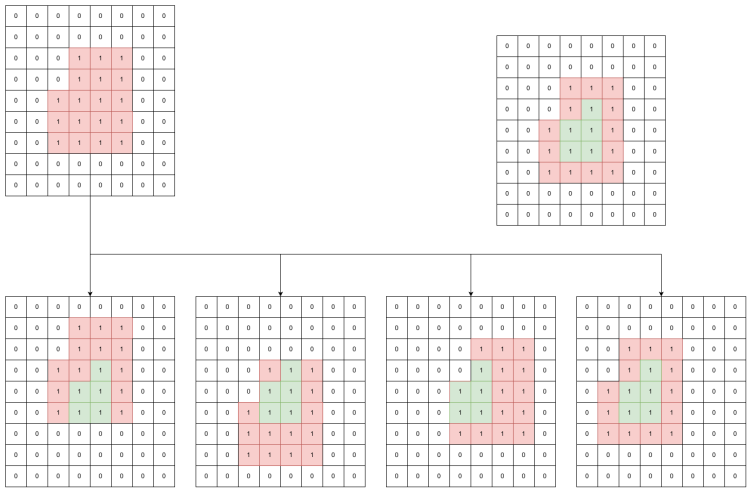

---

```yaml
hideInToc: true
```
# Morphology
## Dilation

- Defined by
$A \oplus B~=~\{z | [(B)_z~\cap~A~]~\subseteq~A~ \}$
	- A is the object, B is the structuring elements
- This equation indicates that the dilation of A by B is the set of all shifts z such that the foreground elements of B, when shifted by z, overlap with at least one element of A. 
- In other words, we generate four images from the object A
- In each one, we shift it up, down, right, and left, then we take the **union** of all these images.
- Dilation grows the object
---

```yaml
hideInToc: true
```

# Morphology
## Dilation

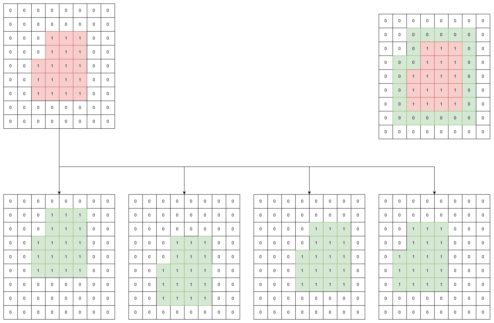

---

```yaml
hideInToc: true
```
# Morphology
## Erosion & Dilation

<div grid="~ cols-2">
<div>

- Erosion:
	It is useful for processing irregular or highly complex edges, helping to smooth or simplify them.
- Dilation: 
	It is useful for repairing breaks or gaps in edges, helping to connect or fill in discontinuities.
</div>
<div>
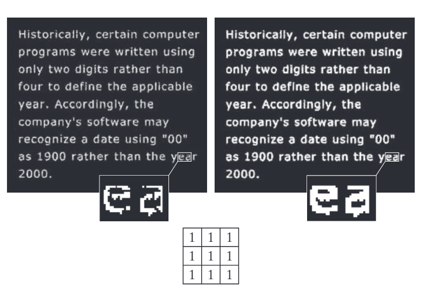
</div>
</div>
---

```yaml
hideInToc: true
```
# Morphology
## Erosion & Dilation

- Because being set operations, there are relationships between erosion and dilation, taking into consideration reflection and complement 
$$
\overline{(A \ominus B)}=\overline{A} \oplus \overline{\hat{B}}
$$
$$
\overline{(A \oplus B)}=\overline{A} \ominus \overline{\hat{B}}
$$
---

```yaml
hideInToc: true
```
# Morphology
## Opening

<div grid="~ cols-2">
<div>

- Defined by the equation $A \circ B=(A \ominus B) \oplus B$
- Explaned by the equation $A \circ B=\cup\{(B)_z|(B)_z \subseteq A\}$
- geometric interpretation:
	- It consists of all parts of the object A that are large enough to fully contain the structuring element B inside them.
	- Practical use:
		- Opening is useful for **removing weak edges or small connections** that might link **two separate objects** in the image, effectively **separating them**.
</div>
<div>
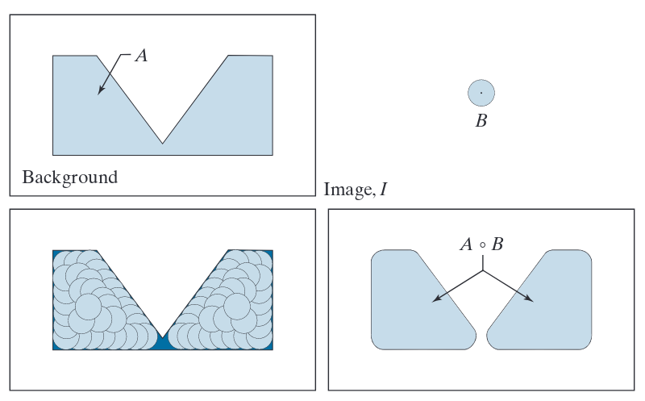
</div>
</div>
---

```yaml
hideInToc: true
```
# Morphology
## Closing

<div grid="~ cols-2">
<div>

- Defined by the equation $A \cdot B=(A \oplus B) \ominus B$
- Explaned by the equation $A \cdot B=\overline{[\cup\{(B)_z|(B)_z \cap A=\phi\}]}$
- geometric interpretation:
	- It consists of all parts of the object A that are encircled completely by the structuring element B.
	- Practical use:
		- Closing is useful for **closing** holes and **strengthen** weak edges.
</div>
<div>
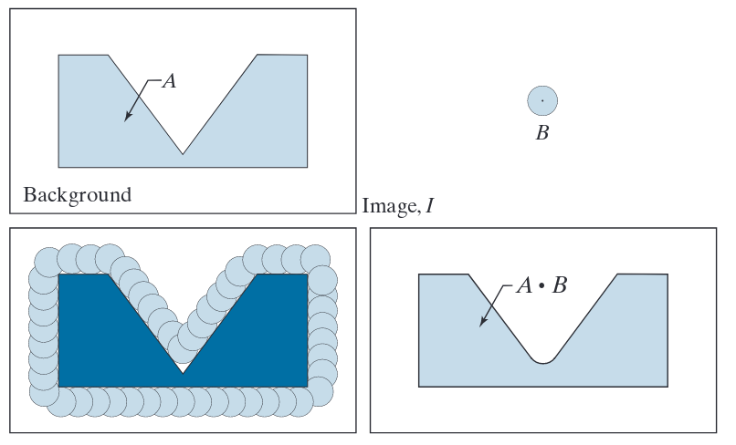
</div>
</div>
---

```yaml
hideInToc: true
```
# Morphology
## Opening & Closing
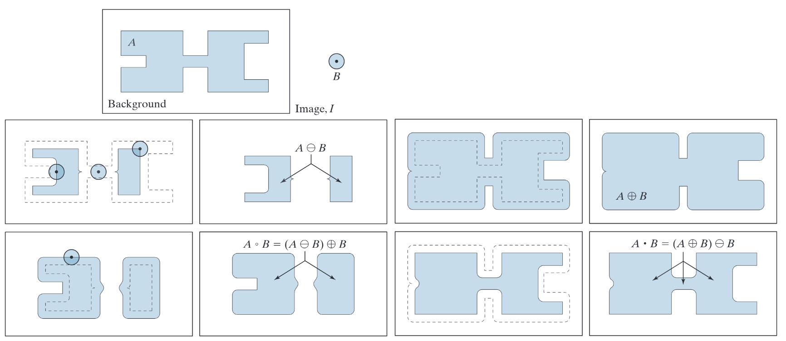

