# Computer Vision

## Lecture 4

### Descriptors and Template Matching

---

```yaml
hideInToc: true
```

# Table of Conent

<toc maxDepth="2"/>
---

# Descriptors

- After we have extracted an object, we need a way to quantify said object (or regions), in other words, we need to find a way to describe that object
- Descriptors can  (including but not limited to): 
  - Shape

  - Texture

---

# Shape

- Shape descriptor can be used to describe the shape of the object using (including but not limited to):

  - Moments

  - Topolgical

  - Fourier Descriptors

---

```yaml
hideInToc: true
```

## 1. Moments Descriptors

We can use several descriptors to describe a shape, such as (P is perimeter and A is area):

- Compactness:

  - The ratio of the object's area to the area of the surrounding circle.  
  - $compactness=\frac{p^2}{A}$  
  - Values are in range $[0,1]$ where 1 is a complete circle

- Circularity (Roundness):   

  - The degree of similarity between the shape and a perfect circle.    
  - $circularity=\frac{4\pi A}{P^2}$

---

```yaml
hideInToc: true
```

## 1. Moments Descriptors

We can use several descriptors to describe a shape, such as (P is perimeter and A is area):

- Elognation:  

  - The ratio of the width of the object's bounding box to length  
  - $elongation=\frac{width_{bounding~box}}{length_{bounding~box}}$  
  - Values are in range $[0,1]$ where 1 is a complete square

- Eccentricity:   

  - The ratio of the length of the short (minor) aixes of the object to length of the short (major axis)   
  - $eccentricity=\frac{axis~length_{short~axis}}{axis~length_{long~axis}}$  
  - Values are in range $[0,1]$

---

```yaml
hideInToc: true
```

## 1. Moments Descriptors

<div grid="~ cols-2">
<div>
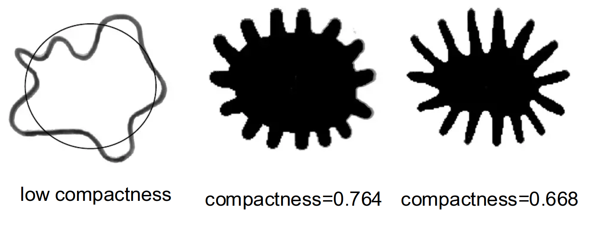
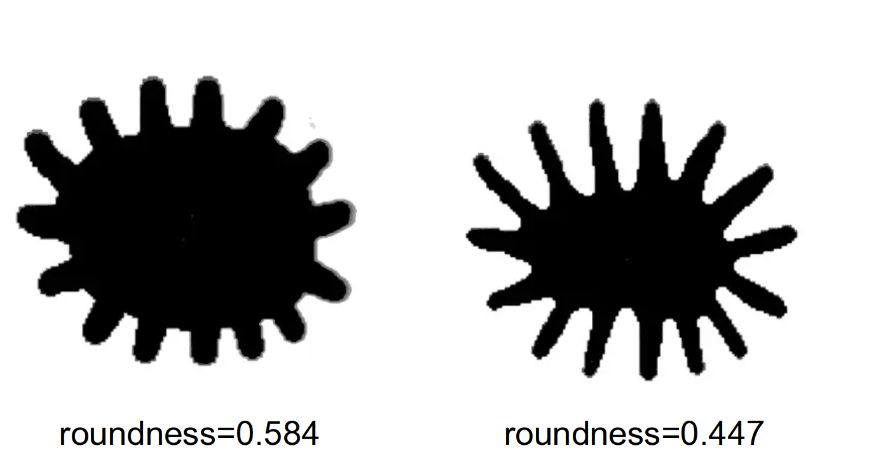
</div>
<div>
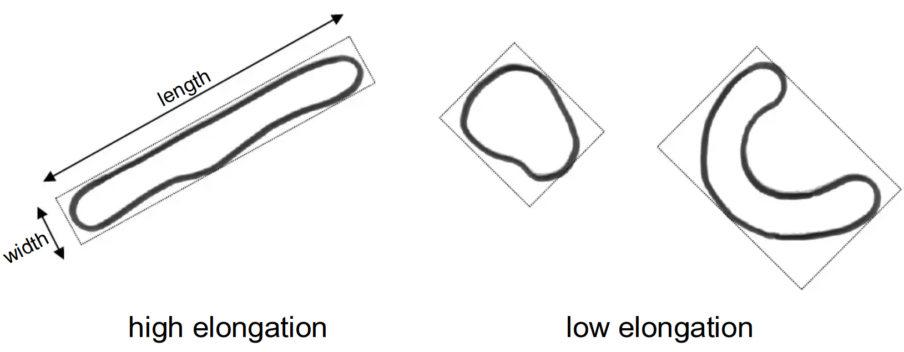
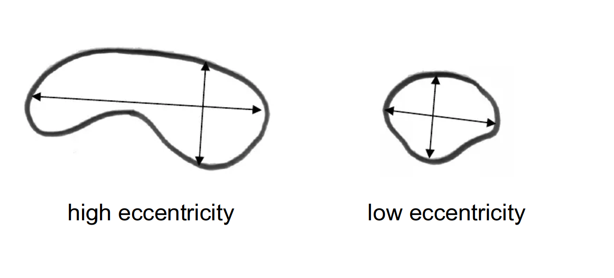
</div>
</div>
---

```yaml
hideInToc: true
```

## 2.Topological Descriptors

<div grid="~ cols-2">
<div>

- Topology is the study of properties of a figure that are unaffected by any deformation, provided that there is no tearing or joining of the figure
- The image on the side shows a region with two holes. 
  - a topological descriptor defined as the number of holes in the region will not be affected by a stretching or rotation transformation.
  - However, the number of holes can change if the region is torn or folded. Because stretching affects distance, topological properties do not depend on the notion of distance or any properties implicitly based on the concept of a distance measure.

</div>
<div>
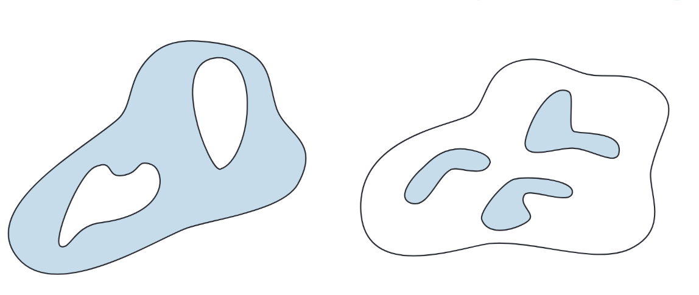
</div>
</div>

---

```yaml
hideInToc: true
```

## 2.Topological Descriptors

<div grid="~ cols-2">
<div>

- Another topological property useful for region description is the number of connected components of an image or region (the second shape in the image)
- We can use Eular Number E to create a realationship between the number of holes and connected components inside the shape:
- $E=C-H$

</div>
<div>

</div>
</div>
---

```yaml
hideInToc: true
```

## 2.Topological Descriptors

<div grid="~ cols-2">
<div>

- In the following picture: 
  - The A letter has 1 connected component and 1 hole, E=0 
  - The B letter has 1 connected component and 2 holes, E=-1

</div>
<div>
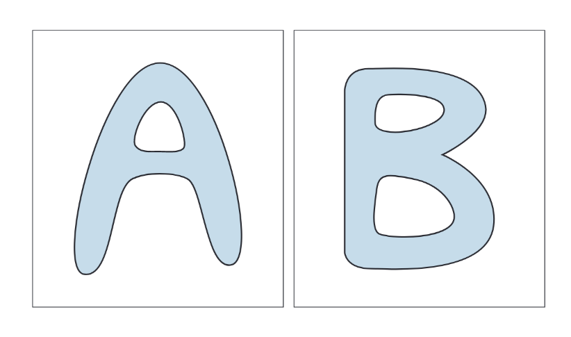
</div>
</div>

---

```yaml
hideInToc: true
```

## 2.Topological Descriptors

- Regions represented by straight-line segments (referred to as polygonal networks) have a particularly simple interpretation in terms of the Euler number
- Classifying interior regions of such a network into faces and holes is often important. Denoting the number of vertices by V, the number of edges by Q, and the number of faces by F gives the following relationship

$$
V-Q+F=C-H
$$

---

```yaml
hideInToc: true
```

## 3. Fourier Descriptors

- Fourier descriptors are a flexible and simple method for representing the two-dimensional shape of an object by applying the Fourier Transform to the boundary of that shape.
- The main idea is to represent a curve using a set of numbers that reflect the frequency content of the overall shape.  
- The method essentially relies on representing the curve and then applying the Fourier Transform to that representation.

---

```yaml
hideInToc: true
```

## 3. Fourier Descriptors

- The boundary pixels are represented — in the simplest possible form — using points (x, y).  
- Thus, the Fourier description of these boundaries is defined as providing a frequency representation corresponding to these points.
- The first component (DC component) represents the mean of the coordinates, hence expressing the center of the shape.   
- The second component represents the radius of the best-fit circle surrounding these points.

---

```yaml
hideInToc: true
```

## 3. Fourier Descriptors

<div grid="~ cols-2">
<div>

- By using a greater number of higher-order components, we achieve a more precise description of the shape since these components correspond to higher frequencies.  
- In general, only a limited number of low-frequency Fourier components are used because high-frequency components are easily affected by noise and provide less significant information about the overall shape.

</div>
<div>
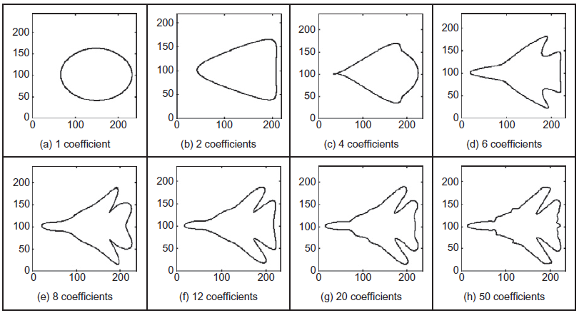
</div>
</div>

---

```yaml
hideInToc: true
```

## 3. Fourier Descriptors

- There are several mechanisms to use Fourier descriptors.  
- We will rely on the centroid-based method.

---

```yaml
hideInToc: true
```

## 3. Fourier Descriptors

### Centroid

- Computation Steps
  1. Compute the center of the object.
  2. Compute the Euclidean distance between the object’s center and each boundary point.
  3. Apply the Fourier Transform to the resulting vector.
  4. Normalize by dividing by the value of the first element of this vector (the DC component).

---

```yaml
hideInToc: true
```

## 3. Fourier Descriptors

### Centroid

<div grid="~ cols-2">
<div>

- The Fourier descriptors obtained this way are invariant to rotation, translation, and scaling.

</div>
<div>
</div>
</div>
---

```yaml
hideInToc: true
```

## 3. Fourier Descriptors

### Centroid

<div grid="~ cols-2">
<div>

- Rotation and translation invariance come from the fact that we calculate the distance between two points; this distance does not change when the object is shifted or rotated.  
- Since we apply the Fourier Transform to the differences, we obtain the same results regardless of the sample order.

</div>
<div>

</div>
</div>
---

```yaml
hideInToc: true
```

## 3. Fourier Descriptors

### Centroid

<div grid="~ cols-2">
<div>

- Scale invariance is related to the DC component.  
- When an object is scaled by a constant factor, this value appears within the DC component of the Fourier Transform (which represents the shape’s center).  
- By normalizing the result through division by the DC component, we eliminate this scaling effect.

</div>
<div>

</div>
</div>
---

```yaml
hideInToc: true
```

## 3. Fourier Descriptors

### Centroid

- How to compare two shapes using Fourier descriptors: 
  - The process is quite complex and requires careful attention.  
  - We take the first _k_ components of the two shapes’ descriptors (preferably a power of 2) and compute the Euclidean distance between them.

$diff~=~\Sigma_k \sqrt{(x_{k,1}-x_{k,2})^2+(y_{k,1}-y_{k,2})^2}$
---

```yaml
hideInToc: true
```

## 3. Fourier Descriptors

### Centroid

<div grid="~ cols-2">
<div>

- Assume we have two shapes, **S₁** and **S₂**,  
- and we take the first _k = 2_ components.

</div>
<div>
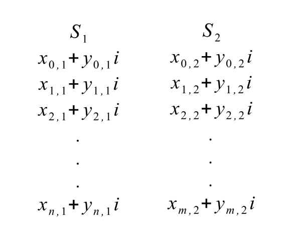
</div>
</div>
---

# Texture Detection

- **Definition:** Texture is a fundamental element in **human visual perception** and is widely used in **computer vision systems**.
- It is defined as a measure of:
  - Roughness
  - Contrast    
  - Orientation       
  - Line similarity       
  - Regularity       
  - Coarseness
- **Conceptually:** Texture represents the **grouping of similar patterns** in an image.   
- **Occurrence:** Natural scenes often contain **quasi-repetitive arrangements of pixel units**, which form textures.

---

```yaml
hideInToc: true
```

# Texture Detection

- Texture analysis plays a major role in describing image content as it captures subtle variations in gray-level gradients that cannot be detected by high-pass filters
- **Key application:** One of the most important uses of texture detection is the detection of camouflaged objects in images.
- **Additional applications:**
  - Medical imaging
  - Detection of cracks in roads
  - Fingerprint analysis
  - And other fields requiring fine pattern recognition.
- Represent The Texture:
  - Gabor Filters
  - Gray Level Co-Occurrence Matrix

---

```yaml
hideInToc: true
```

## 1. Gabor Filters

- One of the simple methods for texture detection in digital images.
- A Gabor filter is defined as the product of a Gaussian filter and a sinusoidal (sine or cosine) wave.
- It is widely used because it can analyze both spatial and frequency information, making it effective for capturing texture, orientation, and spatial frequency in images.
- Defined by $G(x, y) = e^{-\frac{1}{2} \left( \frac{x_r^2}{\sigma_x^2}+\frac{y_r^2}{\sigma_y^2}\right)}\times e^{  i \left( 2 \pi \frac{x_r}{\lambda} + \psi \right)}$
- $\psi$ represents phase
- $\lambda$ represents wave length
- $x_r=x co \theta + y sin \theta$
- $y_r=-x sin \theta + y cos \theta$

---

```yaml
hideInToc: true
```

## 1. Gabor Filters

- When applying Gabor filter, we don't apply a single filter, apply a multiple filters
- In we don't supply all the parameters, we apply only multiple values of $\psi$ & $\lambda$ creating a bank of filters
- With the resulting images, we calculate the average and the standard deviation per resulting image
- The resulting pairs are called gabor response
- To compare responses we use Euclidean distance

---

```yaml
hideInToc: true
```

## 1. Gabor Filters

<div> 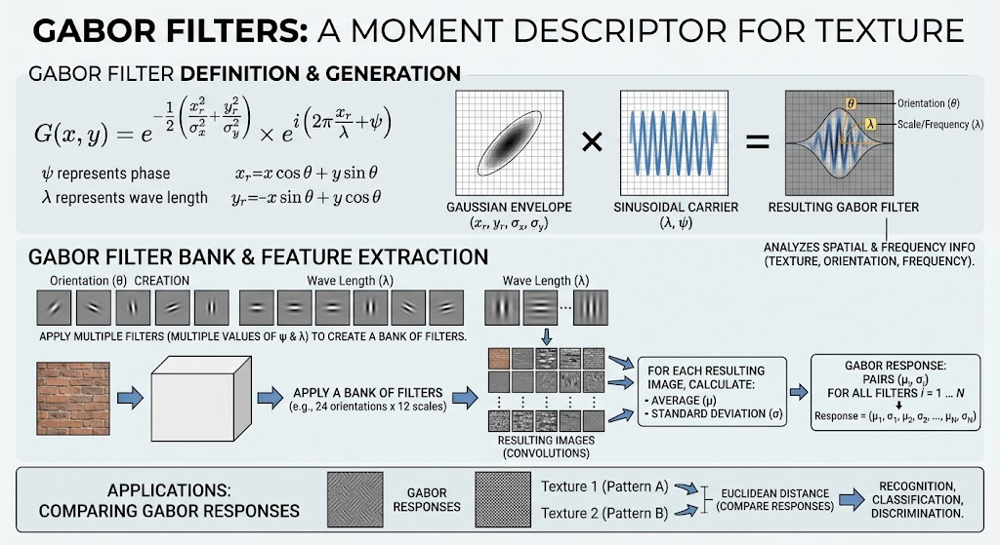</div>

---

```yaml
hideInToc: true
```

## 1. Gabor Filters

- We can apply gabor filters on discovered object to extract information about the object texture (I used gabor filters and fourier descriptors in Master's)

- Another usage:

  - We want to describe the texture inside the entire image

  - As what have been said, we use average and standard deviation to create gabor descriptor, when talking about the entire image, the average value will eliminate a lot of information

  - We use Superpixel to over segment the image, creating homogeneous regions, and we extract gabor descriptor per region giving more accurate representation of the texture in the image, without losing a lot of information .

---

```yaml
hideInToc: true
```

## 1. Gabor Filters

<div>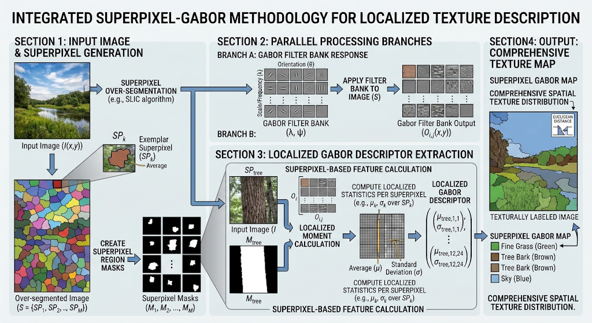</div>

---

## 2. Gray Level Co-Occurrence Matrix

- Texture co-occurrence / Spatial Gray-Level Dependence

  - Used to provide information about the distribution of intensity levels in an image.    
  - Capable of numerically describing the image content.   
  - Defined as the distribution of co-occurring values at a certain displacement (offset). 
  - It can also represent the distance and angular spatial relationship within a subregion of the image of a given size. 
  - This method is based on counting the number of times a pixel value i occurs relative to its horizontal, vertical, or diagonal neighbor j 
  - It forms a square matrix of size N×N, where N is the maximum pixel value in the image.   
  - Each entry in this matrix is calculated based on the frequency of occurrence of the pair (i,j) at a specified direction and distance.

---

```yaml
hideInToc: true
```

## 2. Gray Level Co-Occurrence Matrix

<div grid="~ cols-2">
<div>

- Direction and distance in GLCM: 
  - Direction is measured in angles (e.g., 0°, 45°, 90°, 135°). 
  - Distance is measured in number of pixels between the pair.

</div>
<div>
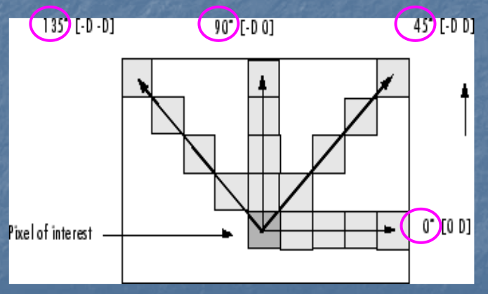
</div>
</div>
---

```yaml
hideInToc: true
```

## 2. Gray Level Co-Occurrence Matrix

<div grid="~ cols-2">
<div>

- Example:     
  - If we want to compute the co-occurrence of pixel values 6 and 7 at distance 2 and direction 0°, this means: 
    - Count the number of times the pair (6,7) occurs in the image.  
    - Such that the second pixel (7) is 2 pixels to the right of the first pixel (6) horizontally (0° direction).

</div>
<div>

</div>
</div>
---

```yaml
hideInToc: true
```

## 2. Gray Level Co-Occurrence Matrix

- A lot of information is obtained from GLCM 

  - Contrast: Measures the amount of variation between a pixel and its neighbor. Higher contrast indicates greater differences. $\Sigma_{i,j} |i-j|^2 p(i,j)$  
  - Homogeneity: Measures the closeness of the distribution of elements in the GLCM to the diagonal. Higher values indicate more uniformity. $\Sigma_{i,j}\frac{p(i,j)}{1+|i-j|}$   
  - Correlation: Measures the degree of linear relationship between a pixel and its neighbor Values range from -1 (negative correlation to 1 (positive correlation). $\Sigma_{i,j}\frac{(i-\mu_i)(j-\mu_j)p(i,j)}{\sigma_i\sigma_j}$  
  - Energy: The sum of squared elements of the GLCM. It reaches 1 for a perfectly uniform image and decreases as texture becomes more varied.$\Sigma_{i,j} p(i,j)^2$

- We can use this technique on objects, images or region just like gabor filters

---

# Template Matching

- A high-level computer vision technique used to identify regions in an image that match a predefined template.  
- Template matching techniques are flexible and relatively easy to use, but their applicability depends on the available computational power — large and complex templates can take a long time to process.

---

```yaml
hideInToc: true
```

## 1. Requirements

- To perform template matching, we need: 
  - A **reference image** of the object (template image)    
  - An **input image** to be searched 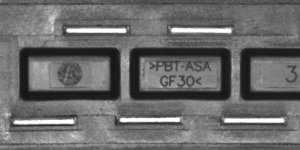 
  - A **matching mechanism** (e.g., Naive, Correlation, Grayscale methods)

---

```yaml
hideInToc: true
```

## 2. Sliding Window

- All the previously mentioned techniques rely on the **sliding window** concept.
- The **sliding window** is a technique that applies a certain algorithm across all pixels of the image, moving pixel by pixel to achieve the desired result.
- All the previously mentioned techniques rely on the sliding window concept — applying an algorithm on each pixel and moving one pixel at a time. 
- Just like appyling filters and morphological operations on image, they all use the concept of sliding window

---

```yaml
hideInToc: true
```

## 3. Sliding Window

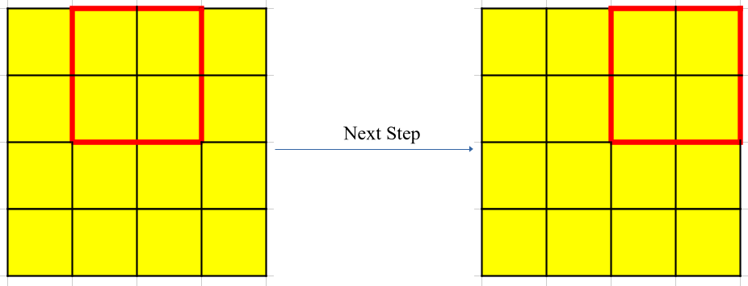
---

```yaml
hideInToc: true
```

## 3. Matching Mechanisms

### 1. Naive Method

- Subtract pixel values from each other.  
- Place the template (sliding window) on the image starting from the upper-left corner.
- Subtract values and compute the sum of differences.    
- Move the template rightward and repeat the computation.    
- Continue until the template has covered all pixels.    
- The locations with the smallest differences (below a threshold) indicate matches.

---

```yaml
hideInToc: true
```

## 3. Matching Mechanisms

### 2. Correlation Method

<div grid="~ cols-2">
<div>

- This method is similar to the naive one, but instead of subtraction, it studies the **correlation** (yes that correlation, same one as filters) between the template and the current region in the image.  
- The template is treated as a filter and applied to the image, producing an **output known as a correlation map**.  
- The higher the value, the better the match.
- Remember, correlation studies the relationship between 2 signals (in our case 2 images)

</div>
<div>
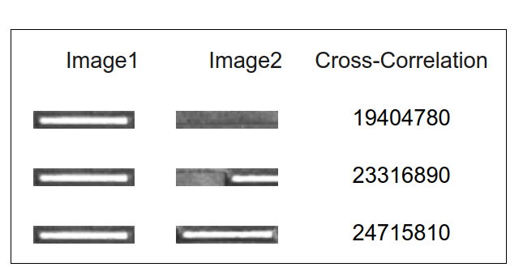
</div>
</div>
---

```yaml
hideInToc: true
```

## 3. Matching Mechanisms

### 2. Correlation Method: Example

- An example of a correlation map is shown, illustrating the region corresponding to the searched template.

  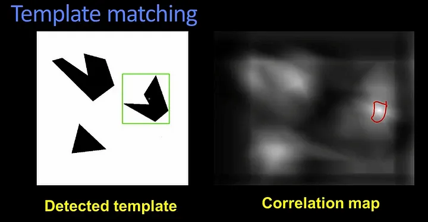

---

```yaml
hideInToc: true
```

## 3. Matching Mechanisms

### 2. Correlation Method: The Problem

- The main problem with this method is that it is **not normalized**, so we cannot determine the absolute best values, only the relatively best ones.  
- To solve this, we use **Normalized Correlation**.

---

```yaml
hideInToc: true
```

## 3. Matching Mechanisms

### 2. Correlation Method: Normalized Correlation

- Correlation Formula: $C=\Sigma~~I(x,y) \times T(a,b)$
- **Normalized** Correlation Formula $Norm_C=\frac{1}{N \sigma_I\sigma_T}\Sigma~~(I(x,y)-\overline{I}) \times (T(a,b)-\overline{T})$
- The **normalized correlation** formula has the following characteristics:
  - Values between [-1, +1]  
  - Resistant to lighting variations

---

```yaml
hideInToc: true
```

## 3. Matching Mechanisms

### 3. Grayscale Method

- What if the image contains the template but it is **rotated**?

  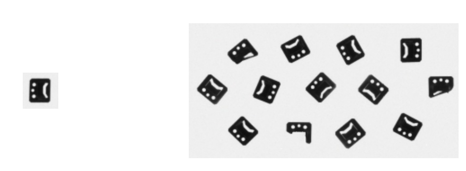

---

```yaml
hideInToc: true
```

## 3. Matching Mechanisms

### 3. Grayscale Method

- This method allows rotating the template at multiple angles and performing matching between each rotated version and the image to determine whether the template is present or not.  
- To reduce processing time, we apply this using an **image pyramid**.

---

```yaml
hideInToc: true
```

## 3. Matching Mechanisms

### 3. Grayscale Method

- We reduce the image and template to smaller sizes several times (e.g., twice, each time by half).

  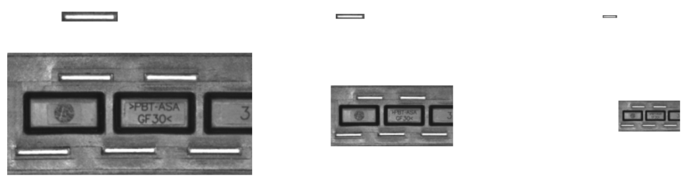

---

```yaml
hideInToc: true
```

## 3. Matching Mechanisms

### 3. Grayscale Method

- Then, we generate rotated versions of the smallest-scale template and apply matching (using correlation or normalized correlation) between each rotated template and the image at that same level.
- For example, if we rotate the template at 20 different angles, and only 3 angles yield high matching scores,  
- we fix those angles and proceed to the next higher level.

---

```yaml
hideInToc: true
```

## 3. Matching Mechanisms

### 3. Grayscale Method

- We repeat the matching process at this level, rotating the template only according to the previously selected angles.  
- We then take the highest matching values, assume it corresponds to one specific angle 
- we apply rotation based on that angle and test the match at the next higher level, and so on,  until reaching the original image and template scale.

---

```yaml
hideInToc: true
```

## 3. Matching Mechanisms

### 3. Grayscale Method

- This technique allows most of the computations to be performed on smaller images.  
- As we move to larger ones, the computational cost decreases, improving performance.  
- There are other models as well, and we should not forget the significant role of **neural networks** in this field.

---

```yaml
hideInToc: true
```

## 4. Summary

- This technique is one of the simplest methods used for **object search and tracking in images**.  
- It can be used for **object tracking in videos**, especially when the object’s movement between consecutive frames is small.  
- It does **not require complex computations**, relying mainly on **correlation**.  
- It can also be used for **object identification** in digital images.  
- To make the process easier, it can be combined with **object detection algorithms**, reducing the search space from the entire image to specific regions.
