# Computer Vision
## Lecture 6  
### Introduction To Neural Networks
---

```yaml
hideInToc: true
```
# Table of Conent
<toc maxDepth="1"/>
    
---

# Historical Overview
- The human brain consists of a **large number of highly connected elements** (about $10^4$ connections per element) called **neurons**.   
- These neurons have **three main components**: **Dendrites**, the **Cell Body**, and the **Axon**:
	- **Dendrites** are tree-like receptive networks of nerve fibers that carry nerve signals to the cell body.
	- The **Cell Body** effectively gathers these incoming signals when they exceed a certain **threshold**.
	- The **Axon** is a single long fiber that transmits the signal from the cell body to other neurons.
	- The point of contact between one cell's axon and another cell's dendrites is called the **Synapse**.
- As a result of studying how biological neural networks work, a theory emerged that all biological neural functions, including **memory**, are stored in the neurons and in the connections between them.
---

```yaml
hideInToc: true
```

# Historical Overview
- The **neuron** is defined as the information processing unit in the neural network.
- The basic neural model consists of the following fundamental elements:
	- A set of Synapsis, or connecting links, each characterized by its own weight or strength. 
    - A collector to aggregate the input signals, such that the total is the result of the product of the previous neurons with the weight of the connection between these neurons and the current neuron. 
    - An activation function to limit the neuron's output. 
    - A Bias (threshold), which affects the increase or decrease of the activation function's input. 
- Despite the mathematical and computational basis of neural networks starting from the late nineteenth and early twentieth centuries,
- The current concept of neural networks did not develop until the 1940s as a result of the research of Warren McCulloch and Walter Pitts.
- These two researchers showed that neural networks are capable of executing any mathematical or logical operation.

---

```yaml
hideInToc: true
```

# Historical Overview
- In 1958, the scientist Rosenblatt developed a practical application of neural networks by building the first Single Layer Perceptron and its associated rules.
- He developed a network that takes as input an image of 20×20 photosensitive cells (pixels by current concepts) and works to classify whether this image is a rectangle or a circle.
- The **artificial neuron (Rosenblatt's neuron)** consists of the following structure:
	<div class="text-center">
	
	$w_o = f \left( \sum_{i=0}^{n} v_i w_i + b \right)$ 
	</div>
- $v_i$​: Input value
- $w_i$​: Weight of this value
- $b$: Threshold, Bias, or Offset
- $f$: Activation function

---

## Rosenblatt Neuron
<div grid="~ cols-2 gap-4">
<div>

- Each of the previous cells connects to a single output cell.
- If the value is greater than the bias, the output is considered 1 (circle), otherwise 0 (square/rectangle).
</div>
<div>
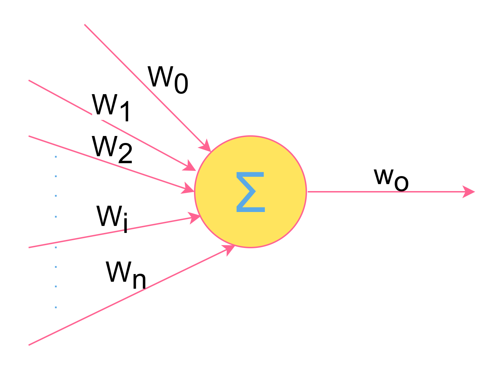
</div>
</div>
---

```yaml
hideInToc: true
```
## Rosenblatt Neuron
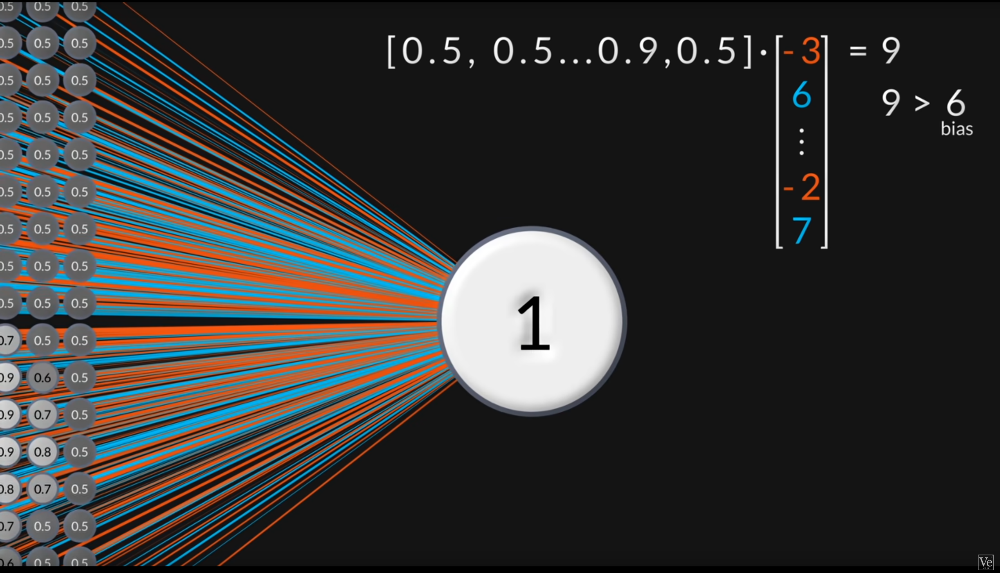
---

```yaml
hideInToc: true
```
## Rosenblatt Neuron
- This network is trained on a set of images of circles and rectangles.
- If the network correctly recognizes the image, the weights are not modified.
- If the expected output value should be 1 but it is 0, the input image is added to the neuron weights.
- If the expected output value should be 0 but it is 1, the input image is subtracted from the neuron weights.
- These steps are repeated until the Convergence stage is reached.
---

```yaml
hideInToc: true
```
## Rosenblatt Neuron
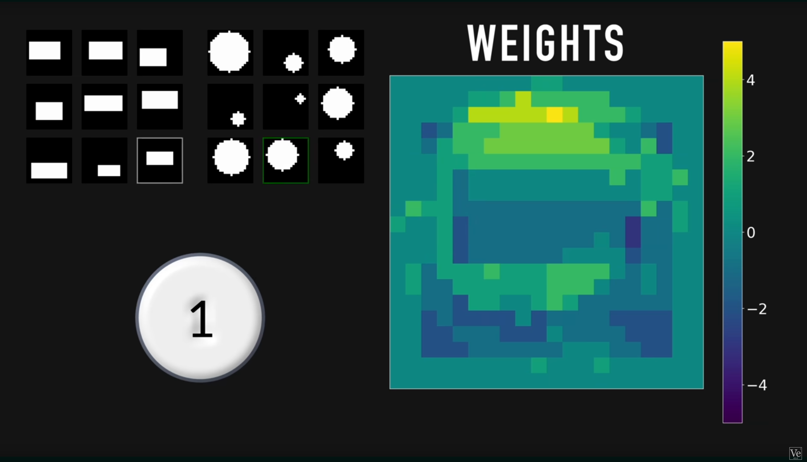
---

```yaml
hideInToc: true
```
## Rosenblatt Neuron
- This very simple neural network model is unable to handle complex problems.
- Rosenblatt was aware of this, as this example treats the problem as a Classification problem and thus suffers from the same classification issues.
---

## Multi Layer Perceptrons
- During the sixties and seventies, research in the field of neural networks was observed to decline.
- However, in the eighties, new concepts emerged that revived activity in this field, namely Multi Layer Perceptrons.
- Multi Layer Perceptrons:
	- These are neural networks that have two or more layers of elements (Input + Hidden Layer + Output).
	- The hidden or internal layers have the ability to discover patterns in the data.
	- One application of this network is autonomous driving.
	- With the development of these networks, a new learning algorithm called Back Propagation was developed, as the previous learning method was ineffective with this type of network.
	- In the human brain, there are neural areas that contain more than one layer to perform different tasks.
---

```yaml
hideInToc: true
```
## Multi Layer Perceptrons
<div grid="~ cols-2 gap-4">
<div>

- The introduction to this type of networks took place in 1980s with an autonomous car driving nerual network made up of:
	- An input layer ($64 \times 64$ image)
	- A 4 neurons hidden layer
	- An output layer of 32 neurons representing the steering angle
	- This network was named **Alvin** and allowed the car to drive at a speed not exceeding **1 km/h** due to the speed of the hardware available in those days.
	- A human driver drove the car to store the various training values for the network to learn from
</div>
<div>
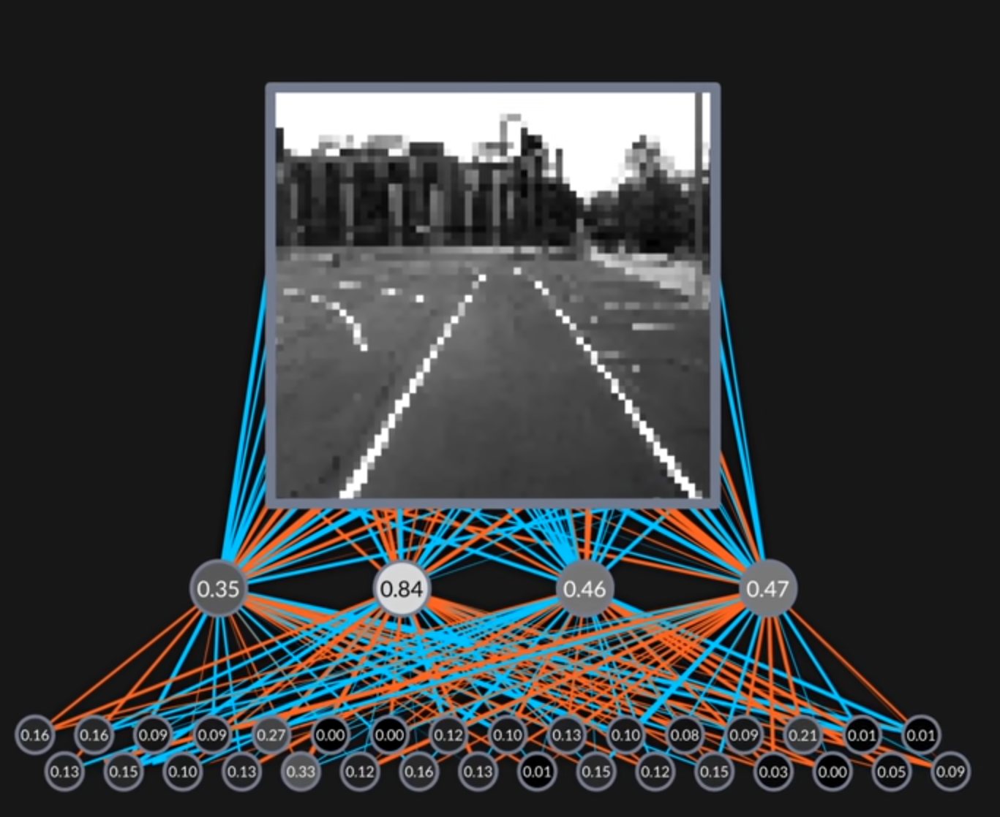
</div>
</div>
---

## The Age of Dataset
- Despite the progress in this field, the fundamental problem was that the results of these networks were not good.
- Researcher Fei-Fei Li was able to identify the reason for the problem: the lack of a sufficient amount of data for training.
- She worked on building the ImageNet collection of images.
- ImageNet: Researcher Fei-Fei Li built the largest collection of labeled images.
	- 1,281,167 training images.
	- 50,000 validation images.
	- 100,000 test images.
	- Distributed across 1000 categories (car, airplane, etc.).
---

```yaml
hideInToc: true
```
## The Age of Dataset
- An annual competition was held, involving universities and companies.
- This competition involves these entities developing neural networks that classify the images in the collection and calculate the error rate.
- The lower the error, the better.
- In 2012, the AlexNet network entered the arena.
	- This network was characterized by a low error rate and high accuracy.
	- It consisted of 8 layers and about 500,000 neurons.
	- The problem lies in which CPU is capable of executing these calculations within a reasonable time.
	- A single image required about 700,000,000 calculations.
---

```yaml
hideInToc: true
```
## The Age of Dataset
- This network was the first to rely on executing the neuron calculations on the GPU (Graphics Processing Unit) rather than the CPU.
- The reason is simple: the process of applying filters to digital images using Convolution is a parallel process, as execution on one pixel does not affect its neighbors.
- Therefore, this process can be highly parallelized.
- Research on neural networks exploded after solving the performance problem.
- Advanced models emerged, such as Convolutional Neural Networks (CNN).
- Networks with memory, such as RNN and LSTM.
- In addition to the emergence of Deep Learning and its branches, primarily Generative Adversarial Networks (GANs) and Diffusion Networks.
- Finally, Transformers and large language models.
---

```yaml
hideInToc: true
```
## The Age of Dataset
<div grid="~ cols-2 gap-4"> 
<div>

- DeepSeek R1:
    - A modern model characterized by low financial cost.
	- Most modern models are a single huge network.
	- DeepSeek R1, however, relies on the Mixture of Experts concept.
	- In this model, several networks are created, each specializing in a specific field.
	- The question is directed to the appropriate network.
</div>
<div>
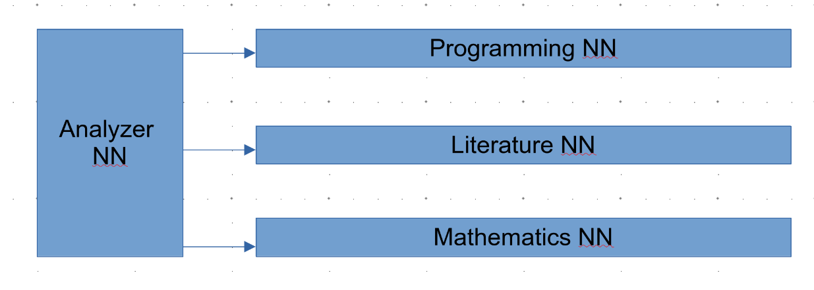 
</div>
</div>

---

```yaml
hideInToc: true
```
## The Age of Dataset
- DeepSeek R1:
	- The cost of training GPT-4o is more than 100 million dollars.
	- The cost of training R1 is 6 million dollars.
	- This figure is not precise.
	- Several new programming techniques were developed by avoiding the CUDA layer.
	- This allowed for accelerated performance.
	- The cost of preparation and experimentation for the new structure adds to the cost of R1.
	- However, these costs are usually distributed across new models developed based on the same technologies.
---

```yaml
hideInToc: true
```
## The Age of Dataset
- Why do you say we live in the age of the dataset?
- Because of transfer learning
- This concept is very simple, instead of building a new neural network from the grounds up - a tedious and expensive endeavor - let's just use an existing one
- But we need to tweak it to match our needs, how to do so you ask? we re-train
- In transfer learning we tune hyper parameters (like number of epochs, activation function,...etc) while retraining an existing model on a new dataset, in the same domain as the original dataset in which the model was trained
	- For example we need to create a model to check  X-Ray images if any image contains cancer cells, we choose an existing model like YOLO v11 (trained on ImageNet) and retrain it on the new X-Ray images to understand the new assignment
- Using the concept of transfer learning a lot of model have been developed based on existing models but more specialized
---

```yaml
hideInToc: true
```
## The Age of Dataset
### Microsoft Tay
<ul>
<li>It was a bot published by Microsoft on the Twitter platform on March 23, 2016.</li>
<li v-click="1">It was equivalent to a teenager in terms of mental capacity.</li>
<li  v-click="2">It was an experiment aimed at studying the interaction between human users and AI systems.</li> 
<li  v-click="3">Microsoft was forced to cancel the experiment after only 16 hours.</li><li  v-click="4">The "nice people" (humans) did not fall short; by the end of this experiment, Tay had become:</li>
<ul class="pl-8" v-click="4">
<li>Misogynistic</li>
<li>Nazi</li>
<li>Racially biased</li>
<li>Its greeting was an insult</li>
<li>In short, they taught it every bad thing</li>
</ul>
</ul>
---

# The Problems with NN
- We can summarize the problems with NN with 3 categories
	- Datasets
	- Energy & RAM
---

## Datasets
- As demonstrated by the catastrophe of Microsoft Tay, in order to achieve good results we need good data
- That is why we refer to Neural Networks as Garbage In - Garbage Out
- This means that the results depend on the quality of the input
	- good input yields good results.
- In the recent times, great efforts have been made to develop **large-sized datasets** suitable for neural networks (the larger the network size, the more data it needs for training).
- These datasets are characterized by being labeled and prepared for training and testing.
---

## Energy & RAM
- We are now suffering from the problem of memory and energy.
- Modern neural network models like GPT-4 are characterized by their large size.
- This size requires a large storage space, especially within the graphics card.
- These cards also require electricity.
- The electricity bill became so high that Microsoft decided to lease and maintain the first generation unit at a nuclear power plant and operate it for 20 years because it is financially cheaper.
---

```yaml
hideInToc: true
```
## Energy & RAM
- The solution lies in Analog Computers
- Before digital computers appeared, we had analog computers that worked on the principle of gears or measuring electrical voltage.
- One of their basic problems is the difficulty of repetition/reproducibility.
- Any slight change in the gear or electrical voltage will cause significant changes in subsequent calculations.
- Despite this, they are characterized by:
	- Low power consumption 
	- Speed in calculations
	- Storing a large amount of data in a small space (higher storage density than digital)
- Several companies are working on developing analog computer systems specifically for Artificial Intelligence that address the problem of repetition/reproducibility.
---

# Back Propagation
- This is the algorithm used to train neural networks
- Some neural networks might require a modification of the algorithm due to its structure, but still the same.
- In this algorithm we study what weight is affects the output in order to change it
- Slow down what?
- I forgot to mention the following:
	- In order  to use neural networks we need to train them
	- Training is simple, we provide the following: 
		- Input data 
		- The expected (real) output 
		- The actual (result) output after processing the input data in the network 
	- We then compare the expected output with actual one 
		- If match, or within a margin of error, then all is well 
		- If not, we need to analyze the weights in the network to identify the guilty parties and change their value
---

```yaml
hideInToc: true
```
# Back Propagation
- The back propagation algorithm is responsible for finding those guilty parties, but it doesn't change them, that is a job for the optimizer
- In order to understand back propagation, we need to understand the following:
	- The loss function: is the function responsible for comparing the expected output to the real
	- The activation function: has the job to limit the output of a neuron in limited range to prevent any explosions in values
---

## Loss Functions
- There are several loss functions, depends on the type of the output and the problem:
	- MSE
	- MAE
	- BCE
	- CE
---

```yaml
hideInToc: true
```
## Loss Functions
<div grid="~ cols-2 gap-4">
<div>

- **MSE**
	- Mean Square Error
	- Uses the following formula: 
		- $E=\frac{1}{N}\Sigma_i (y^e_i-y^a_i)^2$ 
		- $y^e_i$ is the expected output for input i 
		- $y^a_i$ is the actual output for input i
	- Used to detect errors in continuous output
- **MAE**
	- Mean Absolute Error
	- Uses the following Formula: 
    	- $E=\frac{1}{N}\Sigma_i|y^e_i-y^a_i|$ 
	- Used to detect errors in continuous output 
	- Faster than MSE
</div>
<div>

- **BCE**
	- Binary Cross Entropy
	- Uses the following formula: 
		- $E=\frac{-1}{N}\Sigma_i^N (y_i log(p_i)+(1-y_i)log(1-p_i))^2$
	- Used to detect when the output is yes/no based on probablities
- **CE**
	- Cross Entropy
	- Uses the following Formula: 
		- $E=\frac{-1}{N}\Sigma_i^N\Sigma_j^Cy_{i,j}log(y_{i,j})$
	- Used to detect errors in classification
</div>
</div>

---

## Activation Functions
<div grid="~ cols-2 gap-4">
<div grid="~ cols-2 gap-1">
<div>

- Sigmoid
	- Values range between 0 and 1
	- Used with classification problems
 $$
 f(x)=\frac{1}{1+e^x}
 $$
 </div>
 <div>
 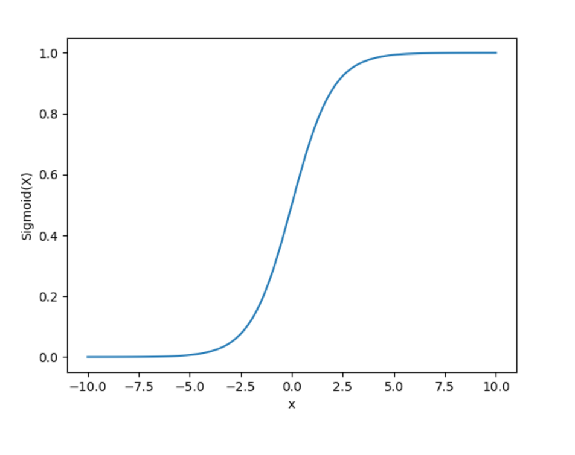
</div>
<div grid="~ cols-2 gap-1">
<div>

- Tanh
	- Values between -1 & +1
	- Used in hidden layers
$$
f(x)=\frac{2}{1+e^{-2x}}-1
$$
</div>
<div>
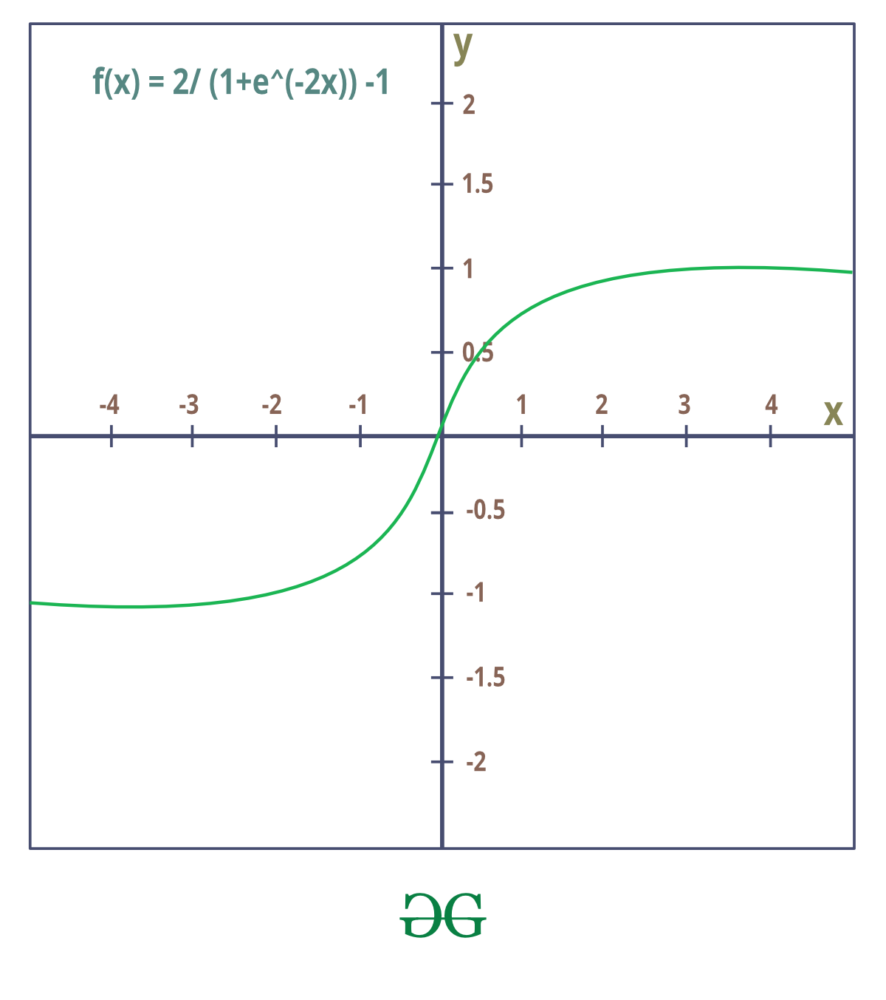
</div>
</div>
<div>

- ReLU
	- Value range between 0 and infinity
	- Used with images a lot
$$
f(x)=max(0,x)
$$
</div>
</div>
---

## Optimzers
- They are the algorithms used to actually change the values, back propagation decides which weight to change while optimizer decides how to change that weight
- Most used optimzers:
	- Adam
	- SGD (Stochastic Gradient Decent)
---

# How to Train Your Network
- The following methods are used to train the neural network:
	- Supervised: we provide the question and the answer and ask the network to solve it to reach the same answer
	- Unsupervised: We simply through the kid in the water, let him/her figure out how to swim
	- Semi-Supervised: a mixture between supervised and unsupervised
	- Re-enforcement: Simply we give points(or treats) for correct answers (like taking an exam, for each correct answer you get part of the total points)
---

# Convolutional Neural Networks (CNN)
- CNNs (Convolutional Neural Networks) are networks that have the ability to perform the convolution operation on a given input.  
- They were initially developed to handle textual sequences, but they have proven highly effective in image processing within neural networks, and are also used in time-series processing.
- The early motivation for convolutional neural networks was derived from experiments on the visual cortex of cats.  
	- The visual cortex contains small regions of cells sensitive to specific regions of the visual field.
	- If certain regions of the visual field are active, those cells are activated.  
	- Activated cells depend on the shape and orientation of objects in the visual field.
	- Some cells are sensitive to vertical edges, while others are sensitive to horizontal edges.
---

## Hierarchical Representation
<div grid="~ cols-2 gap-1">
<div>

- Cells are connected using a multi-layer structure.  
- This led to the hypothesis that mammals use these layers to build image components at different abstraction levels.
- This principle resembles **hierarchical feature extraction**.  
- CNNs encode primitive shapes in early layers and more complex shapes in later layers.
</div>
<div>
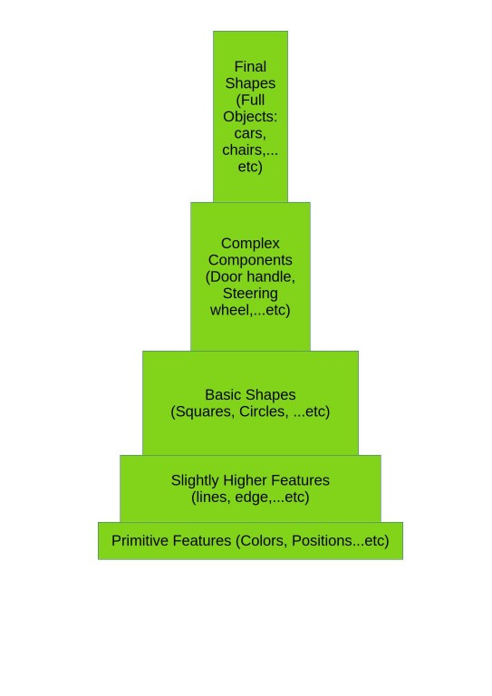
</div>
</div>

---

```yaml
hideInToc: true
```
## Hierarchical Representation
<div grid="~ cols-2 gap-1">
<div>

- CNNs encode primitive shapes in early layers and more complex shapes in later layers.
	- Basic information (pixel locations and color values)
	- Slightly Higher Features shapes (lines, edges)
	- Basic Shapes (Squares, Circles, Rectangle)
	- Complex Components
	- Final shapes
</div>
<div>

</div>
</div>

---

```yaml
hideInToc: true
```
## Local Connectivity

<div grid="~ cols-2 gap-1">
<div>

- In CNNs, successive layers are used, but neurons in the current layer are **not** necessarily connected to all neurons in the previous layer.
- Each feature value is connected only to a **local spatial region** in the previous layer, with shared features across the entire image.
- This is known as **domain-related organization**, where neuron relationships depend on the problem domain, not just weights.
</div>
<div>
<div style="width: 55%">
    
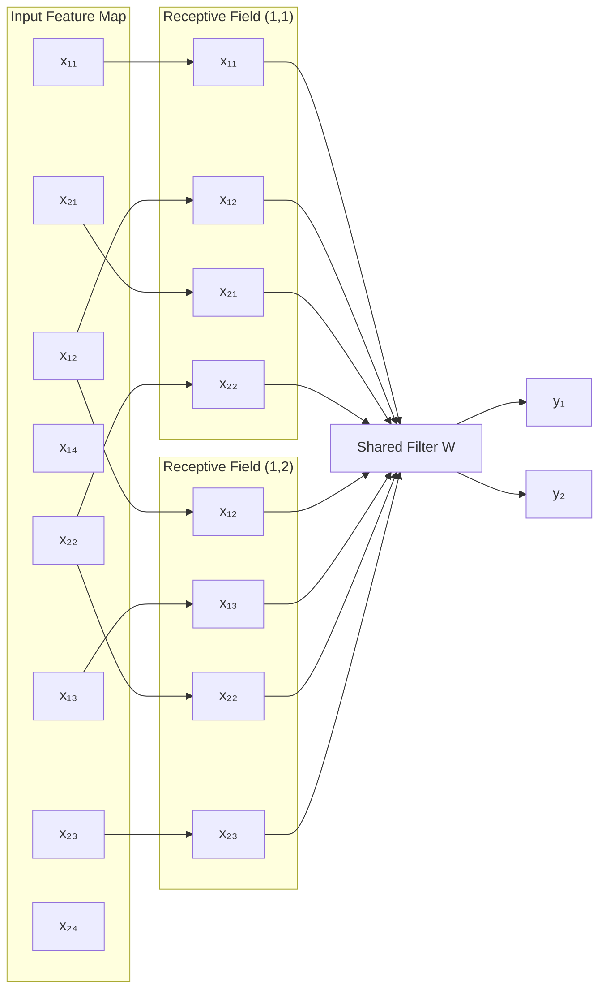

</div>
</div>
</div>

---

## Spatial Structure
- Neurons in each layer are arranged in a structured grid.  
- These spatial relationships are preserved between layers because each feature depends on a local region of the previous layer.
- Each CNN layer is a **3D structure**:
	- Height
	- Width
	- Depth (number of feature maps / channels)
## CNN vs FNN
- A CNN operates similarly to a traditional feed forward neural network (FNN), except that:
	- Operations are spatially organized
	- Connections are sparse
	- Many weights are null 
---


## CNN Layer Types
- CNNs consist of the following layer types:
	- Convolutional
	- Pooling
	- Fully Connected
- They rely heavily on the **ReLU activation function**.
## Input Representation
- Assume the input is an RGB image of size: $32 \times 32 \times 3$
- The initial convolutional layer contains the same spatial dimensions and depth.
- In general, the size of layer $i$ is defined as: $H_i \times W_i \times D_i$
- In convolutional layers, the image length and width are usually equal: $H_i=W_i$
---

## Convolutional Layer 
### Filters (Kernels)
- In convolutional layers, weights are organized into **3D filters (kernels)**.
	- Filter depth equals image depth
	- Filter height and width are smaller than image dimensions
$$
\text{Filter size} = f_h \times f_w \times D_i
$$
	- Applying convolution produces a new image passed to the next layer.
	- The output size is:
$$
H_{out} = H_{in} - f_h + 1
$$
$$
W_{out} = W_{in} - f_w + 1
$$

	- The image shrinks because filters cannot be applied to all pixels.
---

```yaml
hideInToc: true
``` 
### Filters (Kernels)
#### Zero Padding
- If don't want to shrink images, we apply zero Padding
- The number of removed pixels depends on the filter size.
- For a $5 \times 5$ filter:
	- 4 pixels are removed from each side
- Pixels with value 0 are added to each side
---

```yaml
hideInToc: true
```
### Depth
- The depth $D$ of the next layer depends on the **number of filters**.
	- 1 filter → depth = 1 x times the number of channels 
	- 10 filters → depth = 10 x times the number of channels 
- As the network deepens:
	- Spatial dimensions decrease
	- Depth increases
---

```yaml
hideInToc: true
```
### Filters
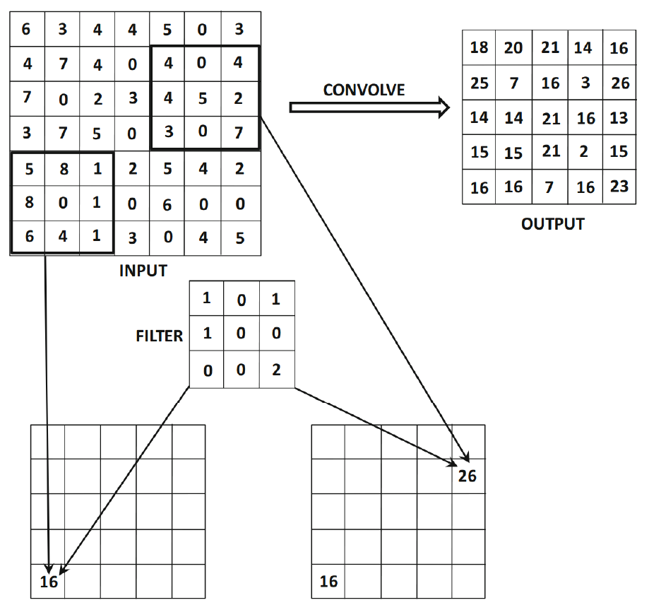

---

```yaml
hideInToc: true
```
### Stride
- The previous example assumes stride $S = 1$.
- **Stride** is the number of pixels skipped during convolution.
- For stride $S$:
$$
1,S_q+1,2S_1+1,...
$$
---

```yaml
hideInToc: true
```
### Pooling Layer
- Pooling is used to:
	- Regularize the network
	- Prevent parameter explosion
- Types of pooling:
	- **Max Pooling**: The maximum value in the neighborhood
	- **Average Pooling**: The average value in the neighborhood
---

### Pooling Layer – Example
<div grid="~ gap-1 cols-2">
<div>

- Max pooling with a $3 \times 3$ window.
- The output size is computed like convolution, but:
	- **Depth remains unchanged**
</div>
<div>
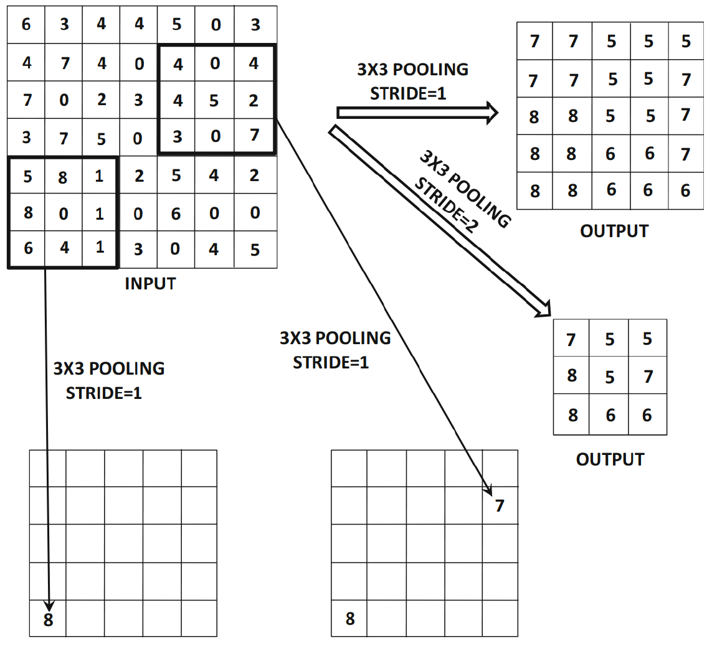
</div>
</div>

---

## Fully Connected Layer
- Every feature in the final spatial layer is connected to every neuron in the first fully connected layer.
- This layer behaves exactly like a traditional FNN.
- Most CNN parameters are located in fully connected layers.
- These layers perform the **final decision-making**.
---

## Layer Arrangement in CNN
- Typical arrangement:
```
CRCRP  CRCRP  CRCRP  CRCRCRP  F
```
- Where:
	- C: Convolution
	- R: ReLU
	- P: Pooling
	- F: Fully Connected
---

## Training CNNs
- Training relies on the **back propagation algorithm**.
- Specific modifications are applied depending on the type of layer being trained.

---

# Handling Videos
- All the networks viewed eralier are about handling single image
- In order to process videos, we need to have information from previous images when processing the current image
- In other words, we need memory
- That is why we use RNN & LSTM 
    - Recurrent Nerual Network 
    - Long Short Term Memory
---

# RNN
- RNNs are especially effective in text processing.
- Example sentence:
	- `The lion chased the deer`
	- Using this simple sentence we will explain the logic of RNN

---

## Architecture
<div grid="~ cols-2 gap-4">
<div>

- A RNN consists of an input layer, output layer, and at least one hidden layer.
- What distinguishes it is that the hidden layer output feeds the next time step through the weight $w_{hh}$
</div>
<div>
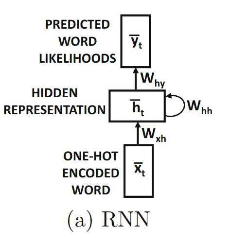
</div>
</div>
---

```yaml
hideInToc: true
```
## Architecture
<div grid="~ cols-2 gap-4">
<div>

- Goal: predict the next word based on the current word and sentence context.
- This will grant us the ability to correctly understand RNN
</div>
<div>
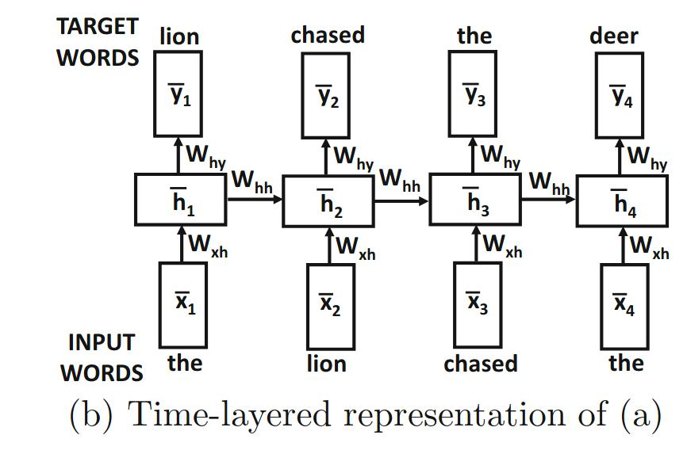
</div>
</div>

---

## Example
### Step 1
<div grid="~ cols-2 gap-4">
<div>

- Input word: **the**  
- Predicted next word: **lion**
- Hidden state $h_1$ is passed to the next time step.
</div>
<div>
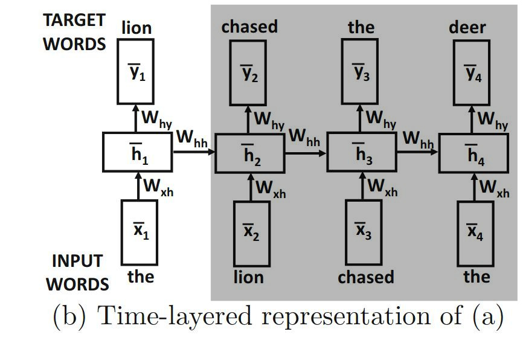
</div>
</div>

---

```yaml
hideInToc: true
``` 
## Example
### Step 2
<div grid="~ cols-2 gap-4">
<div>

- Input word: **lion**  
- Expected next word: **chased**
- This process continues sequentially.
</div>
<div>
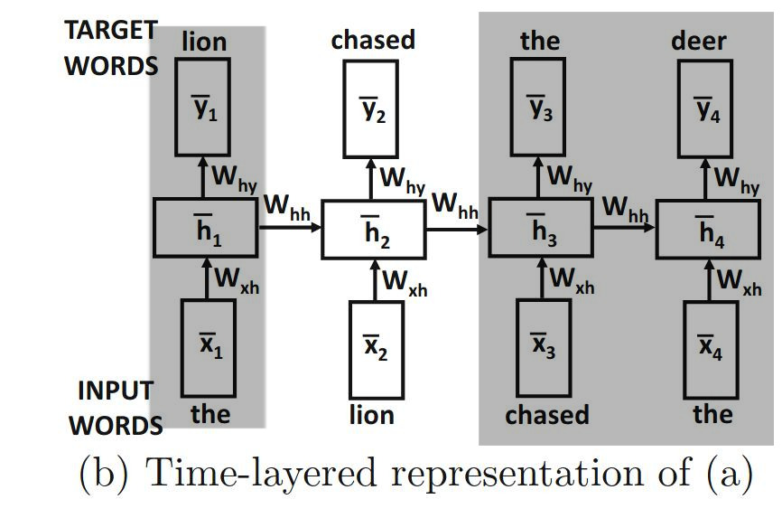
</div>
</div>

---

## Language Models
<div grid="~ cols-2 gap-4">
<div>

- This structure represents a **language model**.
- Language models predict the next word by processing the history of previous words.
- Encoded word sequences are fed in order across time steps.  
	- It's all about feeding the network one word at a time
- The output is a probability vector for the next word.
- Different probability distributions appear at each step.
	- Example:
		- Step 1: **Deer** has highest probability (1.7)
		- Step 2: **Chased** has highest probability
</div>
<div>
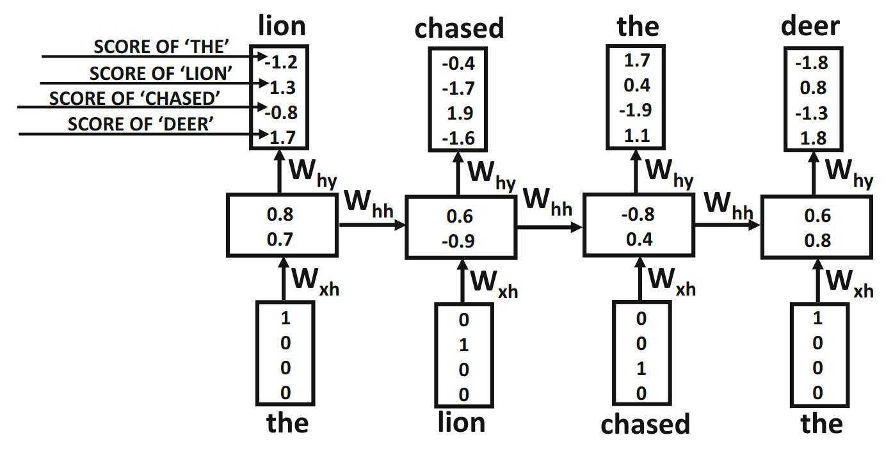
</div>
</div>

---

## Input / Output Variants

<div grid="~ cols-2 gap-4">
<div>

- An RNN does not require input or output at every time step.
</div>
<div>
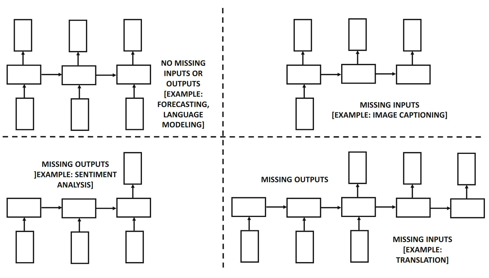
</div>
</div>

---


## Memory
<div grid="~ cols-2 gap-4">
<div>

- The hidden state $h_t$ represents the model’s memory.  
- Increasing hidden layers allows storing more information.
</div>
<div>
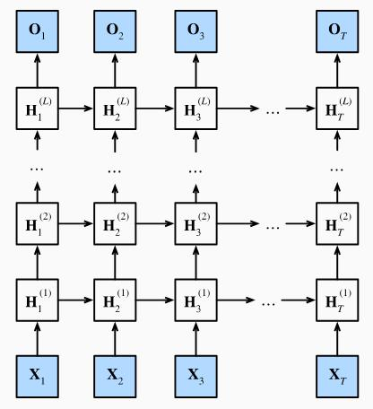
</div>
</div>
---

## Training
- Training uses **Backpropagation Through Time (BPTT)**.
- Gradients from previous time steps are incorporated into learning.
---

## Loss Function
- We use Softmax is used as an activation function.  
	- Assuming we have the output $[y^1_t,y^2_t,y^3_t,...,y^d_t]$
	- We get the result $[p^1_t,p^2_t,p^3_t,...,p^4_t]=softmax([y^1_t,y^2_t,y^3_t,...,y^d_t])$
- Loss is calculated at each time step. $L=-\Sigma_{t=1}^T log(p_t^{j_t})$
- The index corresponds to the expected value at time \( t \).

---

## Bidirectional RNN
- One drawback of RNNs is that the state at a given time step has access only to the previous inputs up to a certain point in the sentence, and it has no knowledge of future states.
	- In some applications, such as word sense disambiguation, performance improves significantly when information from both past and future states is available simultaneously.
	- For example, the specific meaning of a polysemous word like **“right”** in the phrase **“right choice”** (correct choice) cannot be inferred until the word **“choice”** is processed.
	- It can be difficult to determine the correct meaning of a word without processing the positions that follows it.
- Traditional RNNs are not able to achieve this goal, at least to some extent, because any predictions made by an intermediate state that occur before such informative positions and are likely to lack sufficient contextual information.
---

```yaml
hideInToc: true
```
## Bidirectional RNN
- Bidirectional RNNs are well suited for applications in which the prediction process is not limited to a traditional historical window.
- **Classical Historical Window:**  
	- Only past values are analyzed in order to predict subsequent values.
- **Bidirectional Historical Window:**  
	- In this case, both past values and possible future values are analyzed to predict the expected value.
- Although language modeling is causal, prediction accuracy improves using surrounding context.
---

```yaml
hideInToc: true
```
## Bidirectional RNN
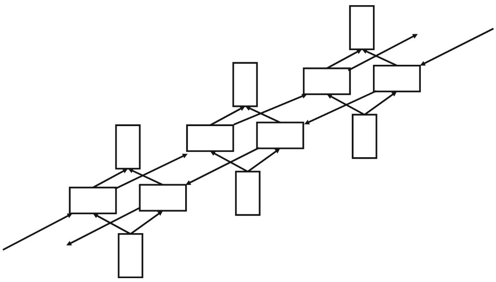

---

## Problems
### Vanishing and Exploding Gradients
- Occurs due to long temporal dependencies.
	- Small learning rate → slow learning (changes don't propagate enough in the network, it vanishes)  
	- Large learning rate → unstable updates (small changes causes massive changes in weight, it explodes)
- Solutions:
	- Clipping
		- **Value clipping:** if \( g > v \), then \( g = v \)
		- **Normalization:** rescale gradients to \([0,1]\)
---

# LSTM
## Motivation
- One of the problems of RNNs is memory retention in long text sequences.
- For example, in the following sentence:  
_"Selecting the left branch at the fork was a mistake, and I should have understood that it made better sense to choose the right one"_
	- The word **“right”** refers to a direction, and the word **“one”** refers to **“branch”**.
- However, due to the length of the sentence, the network may forget this, as it might struggle to correctly interpret it by the end of the sentence, much of the relevant information may have already been distorted through the successive transformations.
---

```yaml
hideInToc: true
```
# LSTM
- To address this problem, the solution is to modify the recurrence equation of the hidden layer using **LSTM** (Long Short-Term Memory).
- LSTM operations are designed to allow precise control over the information stored in this long short-term memory.
- LSTM introduces the concept of a **memory cell** to tackle the storage limitations of RNNs.
- LSTMs are capable of learning long-term dependencies in sequential data, making them highly suitable for tasks such as language translation, speech recognition, and time series prediction.
---

## Gates
- LSTM has three gates:
	- Input gate: Controls the information entering the network
	- Forget gate: Controls the information that should be forgotten by the network
	- Output gate: Controls the output of the network
- This allows LSTM networks to **retain or selectively forget information** as it flows through the network, enabling them to learn long-term dependencies.
- LSTM maintains a **hidden state** (the hidden layer data), which serves as the network's short-term memory. The hidden state is updated based on the current input, the previous hidden state, and the current state of the memory cell.
---

 
## Structure
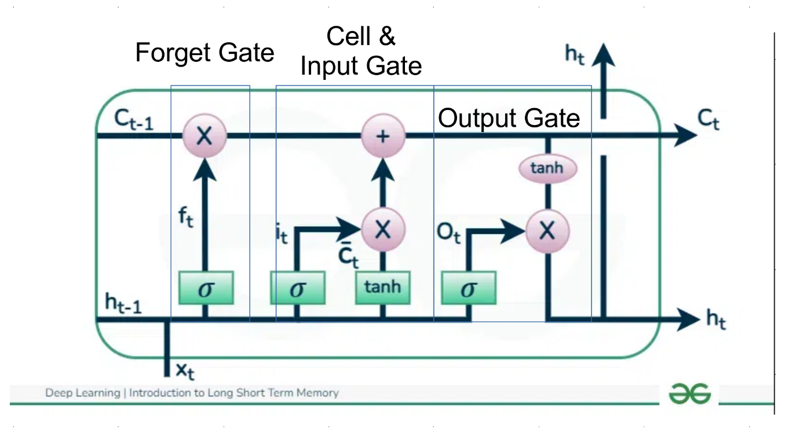

---

```yaml
hideInToc: true
```
## Structure
### Forget Gate
- Controls what information is removed.
	- Non-useful information gets removed from the memory
$$
f_t=\sigma(w_f.[h_{t-1},x_t]+b_f)
$$
<div grid="~ cols-2 gap-4">
<div>

- where:
	- $\sigma$ is the sigmoid function
	- $w_f$ are the weights for the forget gate
	- $h_{t-1}$ the previous output of the hidden layer
	- $C_{t-1}$ the previous state of the cell
	- $b_f$ the bias
	- $[h_{t-1},x_t]$ is array concatination
</div>
<div>

- Output
	- 0 → forget
	- 1 → remember

</div>

</div>

---

```yaml
hideInToc: true
```
## Structure
### Input Gate
- Determines what new information is stored.
$$
i_t=\sigma(w_i[h_{t-1},x_t]+b_i)
\\
\tilde C=tanh(w_c[h_{t-1},x_t]+b_c)
\\
C_t=f_t \odot C_{t-1}+i_t \odot \tilde C
$$
<div grid="~ cols-2 gap-4">
<div>

- Where
	- $i_t$ the importance of the new value
	- $\tilde C$ possible new value
	- $C_t$ the actual new value
	- $w_i$ the input weights
	- $w_c$ the cell state weights
</div>
<div>

- Where
	- $\odot$ element wise multiplication
</div>
</div>

---

```yaml
hideInToc: true
```
## Structure
### Output Gate

- Determines the output of the cell.
$$
O_t=\sigma(w_o[h_{t-1},x_t]+b_o)
\\
h_t=O_t \odot tanh(C_t)
$$
- where
	- $w_o$ the output weights
	- $O_t$ the output of the networks
	- $h_t$ the information sent to the hidden state
---

## BiLSTM
<div grid="~ cols-2 gap-4">
<div>

- BiLSTM consists of two LSTMs:
	- One processes from start to end
	- One processes from end to start
- This provides richer contextual understanding.
</div>
<div>
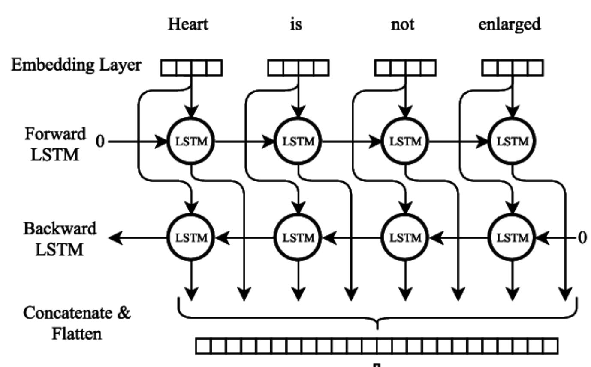
</div>
</div>
